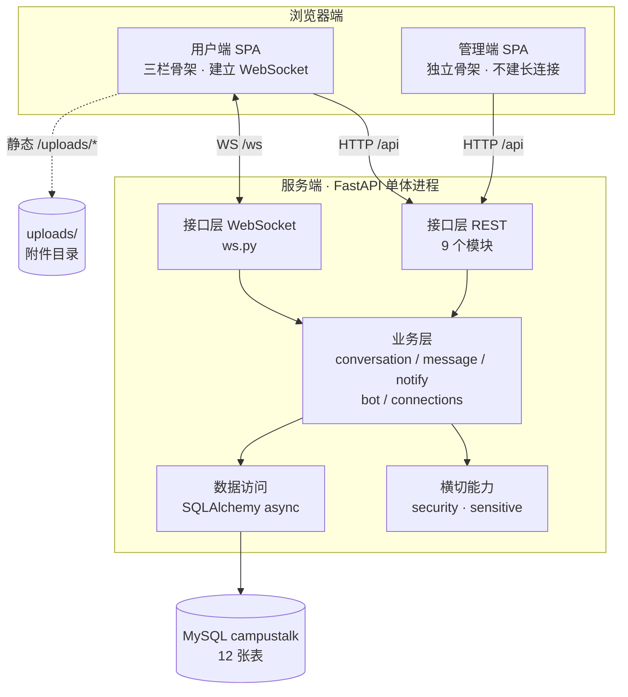
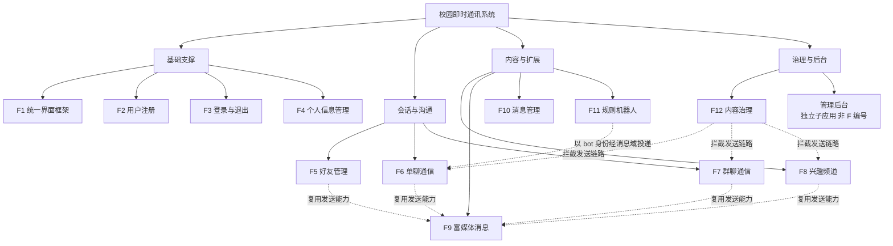
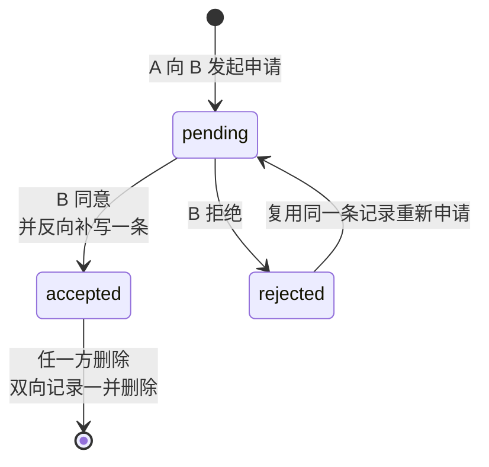
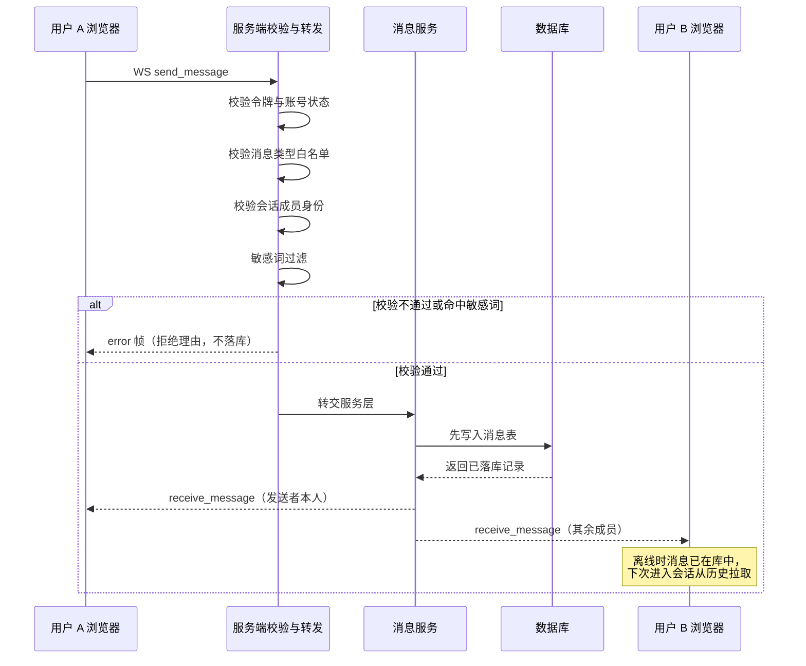
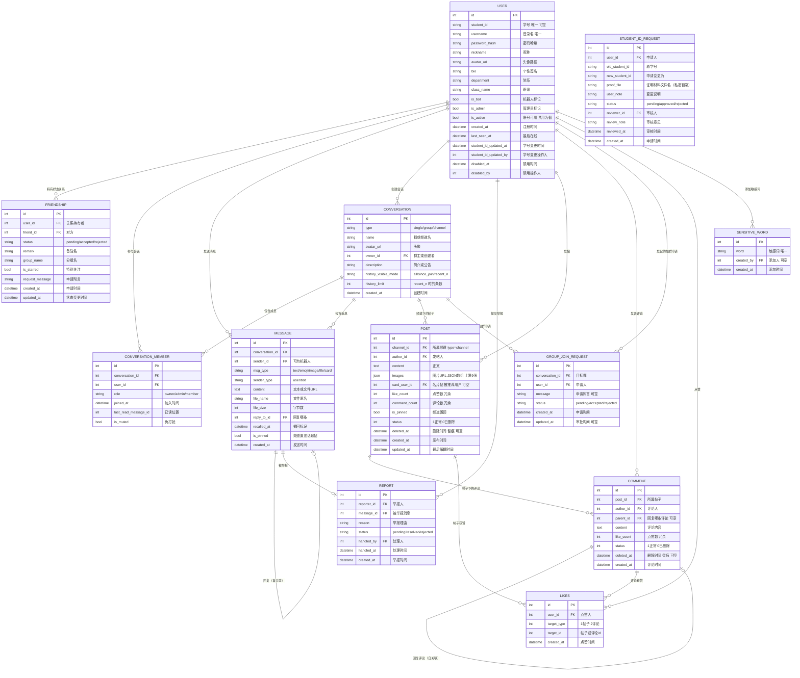

# 第二章 系统设计
> 上游依据：第一章《需求分析》；本项目内部文档《架构与数据设计》。
> 系统名称（暂定）：**校园即时通讯系统（CampusTalk）**

---

## 2.1 系统整体功能结构

系统采用 B/S 结构：浏览器端是单页应用，服务端是一个单体进程。整体结构可用一句话概括——**一个单体、两条通道、两个端、七个域、十一张表**。

服务端不拆微服务，六个业务域与治理能力在同一进程内运行，不引入消息队列、Nginx与容器编排；Redis仅作为广播总线，不作持久存储。对外只有两条通道：REST 负责"会失败的操作"，WebSocket 只负责实时投递，二者职责不混用。浏览器侧是两个端：用户端承载即时通讯，管理端承载治理后台，二者共用同一套后端接口与账号体系，但入口、骨架与权限路径各自独立。服务端按职责划分为身份、关系、会话、消息、内容、机器人六个业务域，外加一个横切的治理域。数据最终落成十一张表：`user`、`friendship`、`conversation`、`conversation_member`、`group_join_request`、`message`、`post`、`comment`、`likes`、`report`、`student_id_request`。

### 2.1.1 分层结构

自顶向下分为四层，**每一层只与紧邻的下一层通信，不跨层调用**。

**表现层**（Vue 3 + Vite + Pinia + Vue Router）由两个端共用一套设计令牌：用户端的三栏骨架承载即时通讯，管理端的独立骨架承载治理操作。这一层不持有任何业务规则，只负责渲染，并把后端给出的拒绝理由显示给用户。

**接口层**（FastAPI）由按域拆分的 10 个路由模块构成。其中 REST 处理注册、登录、好友、会话、内容、治理、上传等"会失败的操作"，WebSocket 处理消息的实时投递。这一层只做参数校验与请求编排，不做业务判断。

**业务层**（`app/services/` 与 `app/core/`）是全系统唯一判断权限与业务规则的地方。会话成员校验、消息落库与推送、系统通知广播、机器人回复都收敛在这里；口令与令牌、敏感词过滤作为横切能力，由 `core/` 提供给各层调用。

**数据层**（SQLAlchemy 2.0 异步栈 + aiomysql + MySQL）负责把十一张表的结构固化为模型定义。图片与文件的本体落在 `uploads/` 目录，数据库里只存 URL、文件名与大小。

依赖方向是 `routers → services → models`。`core/` 作为横切层可被任意层调用，但自身不得反向依赖业务层；`services/` 之间允许互相调用（如消息服务依赖通知服务与连接管理），但一律不得反向导入 `routers`——需要请求上下文时，由路由层把参数传进去。



### 2.1.2 两个端：用户端与管理端

系统在浏览器侧是**两个端**，而不是"一个端加一个管理员区"。二者共用后端与账号体系，但入口、登录接口、骨架与连接方式完全分开：

| 对照项 | 用户端 | 管理端 |
|---|---|---|
| 入口路径 | `/`（登录 `/login`） | `/admin`（登录 `/admin/login`，独立登录口） |
| 登录接口 | `POST /api/auth/login` | `POST /api/auth/admin-login`（非管理员返回 403 且**不签发令牌**） |
| 布局骨架 | `AppLayout.vue` 三栏结构（顶栏 + 左侧分区导航 + 右侧内容） | `AdminLayout.vue`（主色实底顶栏 + 左侧管理导航） |
| WebSocket | 建立并长期保持连接 | **不建立**长连接，纯 REST |
| 页面构成 | 8 个视图 + 4 个联系人面板 | 1 个登录页 + 4 个功能页 |
| 视觉一致性 | 两侧共用 `assets/styles/tokens.css` 的设计令牌，管理端不引入新色值 | — |

用户端由 8 个视图与 4 个联系人面板组成。登录页与注册页是整屏居中卡片，不使用三栏骨架。会话大厅承载欢迎页、未读统计与上手引导。聊天页承载文本、表情、图片、文件与名片五类消息的收发，以及引用回复、撤回、举报与成员侧栏。联系人分区由左侧侧边栏（好友管理、好友通知、群通知）与右侧四类面板（好友管理、通知、好友资料卡、群资料卡）合成，四个面板共用同一路由分区的不同子路径。频道页在"频道广场"与"我的频道"两种模式下复用同一视图，其下钻页是频道帖子流，承载内容层的帖子、两级评论、点赞与置顶。最后的"我的"页把个人资料、学号变更申请与本机偏好设置放在三个子标签中。

与第一章 1.7.1 提出的七个页面相比：登录页、注册页、会话大厅、聊天页、个人资料页、频道广场页六者一一对应；原"好友与申请页"在实现中展开为联系人分区，用四个面板分别承载好友管理与两类通知；此外多出频道帖子流一页，它是频道由"聊天容器"升级为内容社区之后新增的下钻页（见 2.4 的说明）。

管理端只有一个登录页与四个功能页：总览只做计数、不展示任何用户内容；账号管理负责禁用与启用、重置口令、授予与撤销管理员、学号直改；举报处置只呈现被举报的那一条消息；学号审核在调阅证明材料后作出通过或驳回的结论。

### 2.1.3 两条通道：REST 与 WebSocket

**分工原则**：REST 管"会失败的操作"——注册、登录、加好友、建会话、上传、审核，这类操作需要明确的成功或失败回执；WebSocket 只管实时投递——消息到达、撤回通知、置顶变更。两者不混用：不在 WebSocket 里做注册，也不在 REST 里做消息推送。

接口层共 9 个 REST 模块，按业务域拆分：

| 模块 | 路由前缀 | 归属域 |
|---|---|---|
| `auth.py` | `/api/auth` | 身份域 |
| `admin.py` | `/api/admin` | 治理域（全部经 `require_admin`） |
| `verifications.py` | `/api/verifications` | 治理域 |
| `friends.py` | `/api`（`/users/*`、`/friends/*`） | 关系域 |
| `conversations.py` | `/api/conversations` | 会话域 |
| `messages.py` | `/api/conversations` | 消息域 |
| `channels.py` | `/api/conversations` | 内容域（频道帖子 / 评论 / 点赞） |
| `uploads.py` | `/api/upload` | 内容域（附件） |
| `reports.py` | `/api/reports` | 治理域 |

这里有一处必须在结构上讲清的约束：`conversations.py`、`messages.py`、`channels.py` 三个模块**共用 `/api/conversations` 前缀**。拆文件只是为了按文档的域来组织代码，对外路径保持稳定，代价是三者的路由规则会互相影响——FastAPI 按注册顺序匹配，新增同形路径时若顺序不当，会把既有规则遮蔽掉（例如把 `/users/{user_id}` 写在 `/users/search` 之前，`search` 就会被当成一个 `user_id`）。因此本系统的约定是：路径形态相近的接口，静态段一律优先于变量段注册。

WebSocket 只有四种帧。`send_message` 由客户端发往服务端，`msg_type` 限 `text`、`emoji`、`image`、`file`、`card` 五种。`receive_message` 是新消息投递，推给会话内全部成员，**包含发送者本人**——前端以这条回显为渲染依据，因此天然去重、无需本地乐观插入。`system_notice` 用于撤回与置顶变更等状态同步，让其他在线端无需刷新即可看到变化。`error` 承载业务拒绝理由，由前端统一弹出提示。服务端以进程内字典维护"用户 → 连接"的映射，只负责本进程的"最后一米"投递，跨进程广播走 Redis 总线；长连接只在用户端建立，管理端不占用连接。

### 2.1.4 功能模块结构

第一章定义的功能模块为 F1–F12，管理后台（独立子应用）不在其列——它不参与即时通讯流程，只消费治理数据。本节把"十二个模块 + 一个管理后台"按性质归入四组，以体现模块之间的复用与约束关系，而不是平铺罗列。



**第一组是基础支撑**，包含统一界面框架、用户注册、登录与退出、个人信息管理。它们不直接产生业务数据，但为其余所有模块提供身份与入口——界面框架保证各页布局统一，身份体系保证后续操作有主体。

**第二组是会话与沟通**，好友管理、单聊通信、群聊通信三者构成熟人关系链上的完整闭环：先通过检索与申请建立关系，再在单聊中通信，需要多人协作时转为群聊。

**第三组是内容与扩展**。兴趣频道提供"免审加入"的公开讨论区，是本项目区别于通用 IM 的差异化切口；富媒体消息不是独立入口，而是各类会话共用的发送能力；消息管理负责撤回与未读统计；规则机器人以特殊发送者的身份参与聊天。

**第四组是治理与后台**。内容治理在发送链路上拦截违规内容并提供举报入口，管理后台则承担账号与内容的处置。

模块之间不是并列关系。富媒体消息被好友管理、单聊、群聊、频道共同复用，单聊、群聊、频道乃至好友资料卡都走同一条发送链路。消息管理的撤回与未读统计对三种会话形态一视同仁，由同一套代码实现。内容治理嵌在消息与帖子的写入路径上，命中敏感词即拒绝且不落库。机器人不得自行插入消息表，必须经消息域入口投递，才能保证过滤、推送与未读统计一致生效。管理后台则独立于 F1–F12：它不参与即时通讯流程，既不复用三栏骨架也不建立长连接，是与用户端并列的一个端，而不是第十三个功能模块。

### 2.1.5 业务域与数据归属

系统划分为**六个业务域 + 一个治理域**。划分目的只有一条：**每张表只有一个域可以写入**。这条约束在开发后期的价值最明显——任何一条写路径都只有一个入口，出问题时可定位，改逻辑时不会互相打架。

| 业务域 | 职责 | 独占的表 / 目录 | 对外提供的唯一能力 |
|---|---|---|---|
| 身份域 Identity | 注册、登录登出、令牌、个人资料、校园属性、头像 | `user` | 告诉我"这个令牌是谁" |
| 关系域 Relation | 好友申请、同意、拒绝、删除、备注、分组、特别关注 | `friendship` | 告诉我"A 和 B 是不是好友" |
| 会话域 Conversation | 建会话、成员管理、加入策略、历史可见性、加群申请 | `conversation`、`conversation_member`、`group_join_request` | 告诉我"这个人能不能在这个会话说话" |
| 消息域 Message | 落库、历史拉取、实时推送、撤回、已读 | `message` | 把消息存下来并推给该收到的人 |
| 内容域 Content | 内容层：频道帖子、评论、点赞；附件层：图片与文件的上传校验 | `post`、`comment`、`likes`；附件落 `uploads/`（无表） | 给我一个文件还我一个 URL；给我一条帖子并维护它的互动计数 |
| 机器人域 Bot | 指令响应与关键词回复 | 复用 `message` | 作为特殊发送者产生消息 |
| 治理域 Governance | 举报受理与处置、学号变更审核、账号治理与统计 | `report`、`student_id_request` | 对违规内容与账号执行可追溯的处置 |

关于"内容域"需要做一处澄清（原稿在此处的表述需要更正）：它在实现中分为两层。**内容层**由 `post`、`comment`、`likes` 三张表构成，服务于兴趣频道的"论坛 / 朋友圈"形态，读写模式是非实时的内容沉淀，与消息流解耦。**附件层**是图片与文件的上传校验，本身不建表，只负责落盘并返回 URL。之所以出现这一分层，是因为频道的**容器层**（名称、简介、成员、管理员）可以完全复用 `conversation.type='channel'` 的既有代码，但**内容层**无法复用 `message` 表——帖子需要点赞数、评论数、置顶位，而且它不是即时消息，硬用消息表承载会同时破坏两边的读写模型。因此拆出三张独立表：代价是表数量增加，收益是消息流的语义保持干净。

**治理域之所以单列**，是因为它不参与即时通讯的数据流，而是横切在业务之上——举报挂在消息上、学号审核挂在身份上、账号禁用作用于所有域。把它单列出来，是为了明确"平台治理能力"与"聊天功能"是两件事，这也是管理端独立成端的依据。

落到表上：身份域的 `user` 一张表同时承载普通用户、管理员与机器人三类身份，靠 `is_admin`、`is_bot`、`is_active` 三个布尔字段区分，不额外建角色表。关系域的 `friendship` 必须双向存两条，因为备注与分组是关系持有者的私有数据。会话域的 `conversation` 与 `conversation_member` 把私聊、群聊、频道三态合一（靠 `type` 区分），而加群申请之所以单独建 `group_join_request`，是因为它是"待处理事项"，需要保留审批结果供双方回看，成员表只能表达"是否在群里"。消息域的 `message` 靠 `msg_type` 与 `sender_type` 两个字段为后续扩展留出入口，表情、图片、文件、名片与机器人都由此接入。内容域的 `post`、`comment`、`likes` 用冗余计数避免列表页逐条统计，删除采用软删以保留追溯证据，点赞则以多态引用加唯一约束防止重复。治理域的 `report` 与 `student_id_request` 都记录处理人与处理时间，保证每一次处置都可追溯。

### 2.1.6 代码组织与结构的对应

目录结构不是"按文件类型分堆"，而是**按域分目录**——看到任何一张表或一条业务规则，都能直接定位到唯一归属的目录。后端目录如下：

```
backend/app/
├── main.py                    组装：建表、CORS、注册 10 个路由模块、挂载 /uploads
├── config.py                  全局配置（连接串、邀请码、撤回时间窗等，禁止散落到业务代码）
├── database.py                异步引擎与会话（pre_ping / recycle / expire_on_commit）
├── deps.py                    公共依赖：当前用户、管理员校验（真正的权限边界）
│
├── models/                    数据层 · 12 张表，按域拆文件
│   ├── base.py                    Base 与 utcnow（统一存 UTC 朴素时间）
│   ├── user.py                    身份域 → user
│   ├── friendship.py              关系域 → friendship
│   ├── conversation.py            会话域 → conversation、conversation_member
│   ├── message.py                 消息域 → message
│   ├── content.py                 内容域 → post、comment、likes
│   ├── group_request.py           会话域 → group_join_request
│   └── governance.py              治理域 → report、student_id_request
│
├── schemas/                   请求 / 响应模型
│   ├── auth.py                    注册、登录、令牌、资料、改密
│   └── social.py                  好友、成员、消息、加群申请
│
├── core/                      横切能力（不依赖任何业务模块）
│   ├── security.py                口令哈希（bcrypt）与令牌（JWT）
│   └── sensitive.py               敏感词加载与命中判定（消息与帖子共用）
│
├── services/                  业务层 · 可复用规则收敛于此
│   ├── connections.py             进程内连接映射（只投递本进程）
│   ├── bus.py                     Redis广播总线：publish与每实例订阅投递
│   ├── conversation_service.py    成员 / 角色校验、私聊会话幂等创建
│   ├── message_service.py         消息落库与总线发布的唯一入口 save_and_push
│   ├── notify_service.py          系统通知广播、会话成员 id 查询
│   └── bot_service.py             机器人域：指令与关键词回复
│
└── routers/                   接口层 · 10 个模块，只做编排不做判断
    ├── auth.py                    身份域
    ├── friends.py                 关系域
    ├── conversations.py           会话域
    ├── messages.py                消息域（REST 部分）
    ├── channels.py                内容域（频道内容层）
    ├── uploads.py                 内容域（附件层）
    ├── reports.py                 治理域（举报处置）
    ├── verifications.py           治理域（学号审核）
    ├── admin.py                   治理域（账号治理与统计）
    └── ws.py                      WebSocket 端点（只搬运，不写库）
```

前端同样按域组织。`layouts/` 放三套骨架：用户端三栏骨架、联系人分区专用侧边栏、管理端独立骨架。`api/` 是 9 个接口模块，全站唯一的请求出口在 `request.js`。`stores/` 是 7 个 Pinia 状态模块，分别管身份、长连接、会话与消息、好友、加群申请、本机偏好与全局提示。`views/` 放页面（用户端 8 个视图、contacts 面板 4 个、admin 功能页 5 个）。`components/` 是 8 个通用组件——气泡、头像、表情面板、弹窗、轻提示、资料卡、名片刻、加群浮窗。`utils/format.js` 统一处理 UTC 时间解析、文件大小与会话摘要；`assets/styles/` 存放设计令牌与通用元件样式。

两端按同一套域划分组织代码，因此接口模块与后端路由基本一一对应：`auth.js` 对应 `auth.py`，`admin.js` 对应 `admin.py` 与 `auth.py` 的 `/admin-login`，`friends.js` 对应 `friends.py`，`conversations.js` 对应 `conversations.py` 与 `messages.py`（两者共用 `/api/conversations` 前缀，故前端归并为一个模块），`channelContent.js` 对应 `channels.py`，`content.js` 对应 `uploads.py`，`governance.js` 对应 `reports.py` 与 `verifications.py`。`request.js` 与 `token.js` 不属于任何单一域——前者是全站唯一请求出口，后者是令牌读写的唯一入口。

### 2.1.7 架构级强制约束

以下八条是开发期的强制约束。它们不是编码风格建议，而是**一旦破坏就会产生难以定位的缺陷**的结构性规则，因此每一条都连带着破坏后的典型症状。

1. **只向下依赖，不跨层调用**（`routers → services → models`，`core/` 可被任意层调用）。破坏之后，业务规则会逐渐散落到路由里，改一处漏三处。
2. **消息先落库再推送，且只能走消息域入口**。破坏之后，断线期间发出的消息会丢失，未读数也会与实际消息对不上。
3. **WebSocket 处理函数只搬运，不写库、不做业务判断**。破坏之后，同一条规则会在 REST 与 WebSocket 两处各写一份，随时间推移逐渐漂移。
4. **文件只存 URL，二进制绝不进数据库与 WebSocket 帧**。破坏之后，帧体积膨胀会拖慢连接，数据库也会无谓膨胀。
5. **前端不持有业务规则**，只展示后端给出的拒绝理由。破坏之后，绕过前端即可越权，两端的校验口径也会不一致。
6. **每张表只有一个域可写**，跨域判断必须问所属域。破坏之后，会出现"删好友后消息仍可见""撤回后未读数虚增"这类跨域不一致。
7. **对外路径保持稳定；路径形态相近的接口，静态段优先于变量段注册**。破坏之后，新接口会遮蔽既有接口（例如 `search` 被当成路径参数），表现为静默的 404 或 422。
8. **跨进程广播只走 Redis 总线，且只能走 `services/bus.py` 的 publish**；消息先落库再发布，publish 失败不回滚、不上抛。破坏之后（业务代码绕过总线直接循环本地连接表推送），多实例部署时另一批实例的用户会静默收不到消息。

### 2.1.8 与其他章节的衔接

本节只定义结构，各结构的具体展开位置是：十二个功能模块的流程与关键设计见 2.2 系统功能模块详细设计；两个端的页面构成与交互见 2.3 系统界面设计；七个域的表结构、关系模式与索引见 2.4 数据库设计；REST 接口清单与 WebSocket 帧协议见 2.2.14 接口设计；管理后台的功能与权限规则见 2.2.13。

---

## 2.2 系统功能模块详细设计

本章按 2.1 划分的四个模块组逐个说明。基础支撑组包括 F1 至 F4，为其余模块提供界面骨架与身份前提；会话与沟通组包括 F5 至 F7，构成熟人关系链上的完整闭环；内容与扩展组包括 F8 至 F11，是兴趣频道与各项扩展能力；治理与后台组包括 F12 与独立的管理后台。

本章说明各模块的功能与规则，界面构成与交互见 2.3，表结构见 2.4。

### 2.2.1 F1 统一界面框架

用户端的各个业务页面共用一套三栏布局骨架，管理端使用另一套独立骨架。用户端顶栏放置系统标识、当前用户信息与退出入口，左侧为分区导航（会话、联系人、频道、我的），右侧为内容区，各业务页面只填充右侧内容区。管理端顶栏使用主色实底白字，左侧为管理功能导航。两个端共用同一份配色令牌，管理端没有引入新的色值，因此界面风格统一而职责区分明确。

**骨架承担的全局处理**

布局骨架除了承载样式，还是三件全局事务的入口，这也是把它抽成父路由组件、而不是由各页面自行处理的原因。

第一，进入骨架时调用 `GET /api/auth/me` 获取当前用户的完整资料，资料加载完成前不渲染子页面，因为聊天页需要先确定"我是谁"才能判断气泡方向与权限入口。第二，在此统一建立 WebSocket 连接并订阅消息帧，各页面通过状态层读取数据，避免多处重复连接，管理端骨架不建立连接。第三，在此统一处理路由守卫，未登录访问业务页面时按所处区域跳转到对应的登录页，接口返回 401 时清除本地令牌并跳转。

骨架解决的是框架层面的统一。配色与尺寸令牌、通用元件、空状态、加载反馈与确认浮窗等更细的界面约定，见 2.3.11。

### 2.2.2 F2 用户注册模块

注册模块负责创建账号并收集校园身份信息。注册的校验规则全部在服务端执行，前端的提示只用于改善填写体验。注册过程为：前端收集表单并做基础校验，提交注册接口；服务端依次校验用户协议、邀请码、两次密码是否一致、密码强度、用户名唯一性与学号唯一性；密码经哈希处理写入用户表，明文不落库，任何接口都不返回口令字段；注册成功后跳转登录页。

**校验规则**

| 校验项 | 不通过时的提示 | 说明 |
|---|---|---|
| 用户协议 | 请先阅读并同意用户协议 | 内容合规的事前防线 |
| 邀请码 | 邀请码无效，请向管理员获取 | 服务端开启邀请码校验时才校验 |
| 两次密码一致 | 两次输入的密码不一致 | 表单含确认密码字段，后端重复校验 |
| 密码强度 | 密码不能与用户名相同 / 不能与学号相同 / 密码过于简单 | 长度不少于 6 位；命中常见弱口令黑名单即拒绝 |
| 用户名唯一 | 该用户名已被注册 | 用户名是登录凭据兼检索标识 |
| 学号唯一 | 该学号已注册 | 学号是后台实名的载体，一人一号 |
| 全局密码唯一 | 不做校验 | 库中存的是加盐哈希，同一明文各人哈希不同，无法比对；且提示"该密码已被使用"会泄露他人密码 |

口令使用 bcrypt 哈希后存储，注册与修改密码共用同一份弱口令黑名单（`123456`、`password`、`qwerty` 等 11 项），并禁止与本人用户名或学号相同。bcrypt 只处理口令的前 72 字节，超长部分会被截断，因此请求模型将口令长度限制为 72。

**邀请码与准入控制**

邀请码配置在服务端的 `.env` 中（`INVITE_CODE`），非空时校验，留空则开放注册。之所以采用邀请码，是因为本地无法验证用户填写的学号是否为其本人所有，这是所有不接入学校系统的校园应用的共同限制。应对措施按层次划分：

| 层次 | 措施 | 状态 |
|---|---|---|
| 准入 | 邀请码把注册范围收窄到班级或社团 | 已实现 |
| 唯一 | 用户名与学号全局唯一，一人一号，冒用即冲突 | 已实现 |
| 自洽 | 长度、格式、两次密码一致等逻辑校验 | 已实现 |
| 追责 | 操作留痕、举报、管理员封号 | 已实现 |
| 生产化建议 | 对接学校统一身份认证或 edu 邮箱域名验证 | 属部署条件，不在编码范围 |

邀请码机制本身有三个演进阶段。当前实现的是第一阶段：全局单码，换届即换码，局限是无法区分群体、码泄露后需要全员换码。第二阶段可改为邀请码表，为码设置用途、次数上限、有效期与启用状态，把准入粒度细化到班级或届别，单个码泄露只影响一个群体。第三阶段是接入学校统一身份认证，实现免码的身份直连。

机器人账号 `helper_bot` 由初始化脚本预置，标记为机器人，没有学号，不开放注册，也不能登录。

### 2.2.3 F3 登录与退出模块

登录模块校验凭据并签发令牌，用户端与管理端分别使用各自的登录入口。登录流程为：提交登录接口，服务端校验凭据与账号状态，通过后签发令牌；前端保存令牌并跳转会话大厅，管理端跳转总览页；退出时清除本地令牌、关闭 WebSocket 连接，并通知后端记录最后在线时间。

**令牌设计**

令牌使用 HS256 签名，载荷只包含用户 id 与过期时间，密钥配置在 `.env`，有效期默认 1440 分钟。载荷中不放昵称与权限信息，原因是 JWT 无状态、签发后无法撤回，把资料写进令牌会导致用户修改资料后令牌内仍是旧值，因此权限一律在每次请求时查库确认。登录响应只返回令牌、用户 id、昵称与是否管理员五项，完整资料由 `GET /api/auth/me` 单独获取。

令牌的传递分两种方式：REST 接口通过请求头中的 `Authorization: Bearer <jwt>` 传递；WebSocket 连接在查询参数中携带同一令牌，因为浏览器的 WebSocket API 无法自定义请求头。

**登录与退出的安全设计**

用户名不存在与密码错误返回同一句提示"用户名或密码错误"，避免他人通过提示差异判断账号是否存在。修改密码时校验原密码错误也不附带额外信息。

管理端登录入口与用户端分开，口令正确但账号没有管理员权限时，服务端直接返回 403 并且不签发令牌。前端隐藏入口与路由守卫只是体验层，真正的访问控制在服务端，绕过前端直接调用接口同样会被拒绝。

账号禁用需要在三处同时拦截，缺一不可：登录接口拒绝已禁用账号，即使凭据正确也返回 403；鉴权依赖在每次请求时校验账号状态，使该账号已签发的旧令牌立即失效，不必等待过期；WebSocket 握手时校验账号状态，避免禁用后仍能继续收发消息。如果只实现其中一两处，会出现禁用后换个标签页仍可继续使用的情况。

退出登录采用无状态处理。服务端不维护会话白名单，令牌失效由前端清除本地令牌完成，服务端侧的在线状态在该 WebSocket 连接断开时从连接表中移除。退出接口的作用是记录最后在线时间。

### 2.2.4 F4 个人信息管理模块

个人资料页用于查看与修改个人资料、修改密码、申请变更学号，以及设置本机界面偏好。资料修改采用部分更新语义：请求中未提供的字段表示不修改，而不是清空，前端因此可以只提交用户实际改动过的项。

**可修改范围**

| 字段 | 是否可自助修改 | 说明 |
|---|---|---|
| 昵称、个性签名、头像、院系、班级 | 可以 | 转专业、分班是真实场景，限制修改反而失真 |
| 用户名 | 不可以 | 用户名是登录凭据兼检索标识，修改会连带影响他人 |
| 学号 | 不可以，需走审核通道 | 学号是后台实名的载体，自助修改等于实名作废 |

修改密码时校验原密码、新密码两次输入一致且与原密码不同，新密码同样经过弱口令黑名单检查。提示音、免打扰与界面缩放三项本机偏好保存在浏览器本地，不入库也不上传，它们只影响本机显示效果，不影响其他用户看到的内容，因此没有对应的后端接口。

**学号变更的申请与审核**

转专业、留级或教务录入错误等情况确实存在，因此提供一条有证据、有审核、有留痕的变更通道。

1. 提交申请时填写新学号与变更说明，并上传证明材料。后端校验新学号非空、与当前学号不同、未被他人占用，且申请人没有处于待审状态的申请，避免重复提交堆积；
2. 证明材料只接受 jpg、png、webp 三种格式且不超过 10MB，保存到私密目录，数据库中只记录文件名；
3. 管理员调阅材料后作出通过或驳回的结论。通过时再次校验学号唯一性，因为提交到审核之间该学号可能已被他人占用；驳回必须填写理由；
4. 无论结论如何，审核完成后立即删除证明材料原件，只保留申请记录与审核记录。

证明材料与聊天图片的处理方式不同：

| 维度 | 聊天图片与文件 | 学号变更证明材料 |
|---|---|---|
| 存放目录 | `uploads/`，挂载静态路由 | `private_uploads/`，不挂载静态路由，拿到文件名也无法直接访问 |
| 读取方式 | 直接访问文件地址 | 只能通过管理员鉴权的接口读取 |
| 敏感程度 | 低，用户主动公开 | 高，含姓名、学号与证件照 |
| 留存策略 | 长期保留 | 审核结论作出后立即删除原件 |

学生证照片属于敏感个人信息，如果沿用公开的 `uploads/` 目录，任何拿到文件名的人都能无鉴权打开。私密目录、鉴权接口与用后即删三者结合，构成最小可用与最小留存的处理闭环。

### 2.2.5 F5 好友管理模块

好友模块负责检索用户、发起与处理好友申请、维护好友信息（备注名、分组、特别关注）以及删除好友。好友关系的状态流转如下：



**好友关系存两条记录**

好友关系在数据库中存两条：A 与 B 成为好友后，同时存在 `(A, B, accepted)` 与 `(B, A, accepted)`。不能只存一条的原因是备注名与分组属于关系持有者的私有数据，我为 B 设置的备注不应出现在 B 自己的好友列表中，只有两条记录才能各自保存各自的备注与分组。删除好友时双向两条记录一并删除。

**申请的处理**

发起申请时校验不能添加自己、目标用户存在且不是机器人。如果双方已是好友或已有待处理申请，直接拒绝并说明当前关系状态。曾被拒绝的申请允许重新发起，此时复用原记录：把状态改回待处理、更新附言与申请时间、清空处理时间。之所以复用而不是新建，是因为 `(user_id, friend_id)` 上有唯一约束，插入新行会失败。

申请列表对两个方向都返回全部状态。如果只返回待处理记录，发起方在对方处理之后就看不到这条申请了，会出现申请凭空消失的情况；保留已同意的记录还有一个用处，可以从这条记录直接打开资料卡发消息。

同意申请时需要写两处数据：把原记录状态改为已同意，并反向补写一条对方持有的记录；随后建立或复用双方的私聊会话。

**检索范围与名片消息**

加好友只支持按用户名精确匹配，昵称与学号都不参与检索。昵称可能被填写为真实姓名，学号属于半敏感信息，如果这两者可以检索，等于开放了按姓名搜人的骚扰通道。联系人页也不提供按昵称或学号搜索的入口。"找同班同学"是唯一的弱检索入口，按班级精确匹配，范围天然受限。

聊天中可以转发好友名片，消息类型为 `card`，内容字段保存被推荐用户的 id。接收方点击名片可以直接查看对方资料并发起好友申请，但申请仍需要对方同意，名片只是更便捷的入口，没有绕过审批。机器人账号不能被推荐为名片。

打开私聊会话的接口在目标 id 等于自己时跳过好友关系校验，因为自己当然不是自己的好友。这对应一个只有自己一个成员的单聊会话，可用作备忘录。

### 2.2.6 F6 单聊通信模块

单聊通信负责与好友收发消息、查看历史消息与统计未读数。消息的处理链路与群聊、频道完全相同，差别只在会话的成员构成。

**消息发送流程**



消息的处理顺序是先写入数据库、再通过 WebSocket 推送，这是消息不丢失的保证。推送对象包含会话内的全部成员，发送者本人也会收到一份，前端以收到的这条回显作为渲染依据，不做本地插入，因此不会出现重复。如果 WebSocket 断开，消息已经在库中，刷新页面即可看到，所以前端只需做断线重连，不需要补偿队列。

消息的写入与推送集中在 `services/message_service.py` 的 `save_and_push()` 中，它负责写入消息记录、读取发送者昵称与头像、组装消息帧、解析成员列表后向 Redis 广播总线发布一帧；各后端进程实例从总线收到帧，投递自己表内的在线连接。其他代码包括机器人都不能绕过它直接写消息表，否则推送对象与未读统计会立刻出现不一致。

**历史消息与未读统计**

历史消息按游标分页，游标取上一页最早一条消息的创建时间，默认每页 20 条、最多 50 条，返回结果按时间正序排列，前端顺序渲染，上滑时把更早的一页拼接到前面。私聊历史对双方全部可见。

未读数量基于会话成员记录中的已读位置字段计算，统计时排除自己发送的消息与已撤回的消息。前者不构成未读，后者如果计入，会出现打开会话后什么都没有的情况。打开会话时调用已读接口，把已读位置更新为当前最新一条消息。

私聊会话在双方成为好友后按需创建，不预先建立。创建逻辑先查找双方共同所在且成员恰好为两人的单聊会话，命中则复用，否则新建，因此重复调用不会产生多余的会话。

### 2.2.7 F7 群聊通信模块

群聊负责创建群、邀请或申请加入、成员管理、群内收发消息、配置历史可见性以及退出群聊。

**建群与成员角色**

创建群聊时提交的初始成员会与创建者的好友列表逐一比对，出现非好友则整体拒绝，这样群聊不会在建立之初就包含陌生人，加人由后续的邀请与申请两条通道处理。创建者自动成为群主。成员角色分群主、管理员与普通成员三档，改名、改头像、移除成员、审批加群与设置历史可见性都要求群主或管理员权限。

**加群申请流程**

群聊的加入需要审批，流程分三步。

1. 预览：知道群号即可查看群名称、头像、简介、成员数与群主，不要求是群成员。返回结果同时带有"我是否已在群"与"我的申请处于什么状态"，前端据此决定按钮是否可用；
2. 申请：附言可选，只写入一条待处理记录，不修改成员表。已在该群或已有待处理申请时拒绝。申请被拒绝后允许重新申请，复用同一条记录，因为 `(conversation_id, user_id)` 上有唯一约束；
3. 审批：由该群的群主或管理员处理。同意时写入成员表，如果申请人已在群中则跳过，保证重复操作结果一致。审批结果双方都能回看，发起方在"我发出的申请"中看到结果，群主在"待我审批"中看到记录。

除申请外，群主与管理员也可以直接邀请自己的好友入群，需要校验对方尚未在群中。

**历史可见性**

群聊可以配置新成员能查看多少历史消息，有三种模式：

| 模式 | 含义 | 查询代价 |
|---|---|---|
| 全部可见 | 所有历史消息都对新人可见 | 基准 |
| 仅加入之后 | 只能看到加入时间之后的消息 | 查询增加一个时间条件 |
| 仅最近若干条 | 只能看到最近 N 条，N 由配置字段决定 | 需要先定位第 N 条的时间作为下界，多一次查询 |

有两点需要说明。第一，后两种模式是互斥的，选择"仅最近若干条"时不再考虑加入时间，可见范围就是最近 N 条。第二，该配置只对群聊生效，频道的历史对新成员全部可见，私聊的历史对双方全部可见，接口对非群聊的会话直接拒绝设置，避免出现设置了却不生效的情况。

移除成员只删除成员记录，不删除该成员已发送的消息。被移除者若要重新加入，群聊需要重新走申请审批流程，而频道可以直接免审加入，这一差异来自两种会话不同的加入策略。退出群聊则删除自己的成员记录，非成员调用会被成员校验拒绝；退出不删除历史消息，重新加入后仍按可见性规则查看。

### 2.2.8 F8 兴趣频道模块

兴趣频道是面向兴趣主题的公开讨论区，成员可以自由加入、发帖、评论与点赞。

**两层结构**

兴趣频道在实现上分两层。容器层复用会话表（类型为频道），与群聊共用成员管理、加入退出与权限判定的代码；内容层使用帖子、评论、点赞三张独立表，承载帖子的点赞数、评论数与置顶状态。

内容层没有复用消息表的理由是两者的读写模式不同。帖子是非实时的内容沉淀，需要冗余的点赞数与评论数，需要支持按热度排序，还需要置顶位；消息流则严格按时间顺序读写。硬用消息表承载会同时破坏两边的语义，因此单独建表。

**免审加入与频道检索**

加入频道没有门槛，不需要邀请或审批。但加入频道与在频道内发言是两件事：发言同样经过敏感词过滤与举报机制的约束。这一点在设计上需要分开表述，前者表示随时可以进来浏览，后者表示进来之后依然要遵守内容规范。

频道广场的搜索框按关键词匹配频道名称与简介，没有按院系筛选的功能。院系信息会随频道一并返回（取自创建者的院系）用于展示，但不作为筛选条件。

**帖子、评论与点赞**

发帖要求正文、配图、名片三者至少有一项非空。配图最多 9 张，且必须是上传接口返回的地址。正文需要经过敏感词过滤，与消息使用同一份实现。帖子只能由作者本人编辑；删除允许作者本人、频道管理或系统管理员操作，采用软删除方式，原记录保留，便于被举报时追溯。

帖子置顶与聊天消息置顶的规则不同：帖子的置顶不唯一，列表按置顶优先、再按时间或热度排序，可以同时置顶多条帖子。

评论支持两级。回复二级评论时，服务端会把父评论指向所属的一级评论，因此数据结构始终保持两层，不需要递归查询。被软删除的评论保留占位，正文显示为已删除，因为其下的回复仍需定位到父评论。

帖子与评论共用一个点赞表，用类型字段区分（1 表示帖子，2 表示评论），并通过唯一索引保证一个用户对同一目标只能点赞一次。接口设计为幂等：重复点赞与取消未点赞的记录都直接返回成功，同时同步维护目标表上的点赞数。

### 2.2.9 F9 富媒体消息模块

富媒体模块负责文本、表情、图片、文件与名片五类消息的发送与接收。

**消息类型**

| 类型 | 内容字段存放 | 前端渲染 |
|---|---|---|
| 文本 | 文本原文 | 文本气泡 |
| 表情 | 表情字符 | 表情气泡，字号加大 |
| 图片 | 上传接口返回的地址 | 内联图片，点击放大 |
| 文件 | 上传接口返回的地址 | 可下载的文件卡片，显示原文件名与大小 |
| 名片 | 被推荐用户的 id | 好友名片卡片，点击可查看资料并发起申请 |

服务端对消息类型做白名单校验，不在上述五种之内的一律拒绝。早期设计中的系统提示类型与 AI 总结类型均未接入，撤回与置顶变更改由前端根据系统通知帧本地渲染提示文案。

**上传流程与约束**

1. 前端按类型预检文件大小与格式，这一步只用于提前提示；
2. 提交上传接口，服务端重复校验：只依据 MIME 类型判断，图片限 jpg、png、gif 三种且不超过 10MB，文件走白名单（文档、表格、演示文稿、压缩包、音频、视频共 12 类）且不超过 50MB；
3. 文件保存时使用随机文件名，扩展名由服务端根据 MIME 类型推导，不沿用客户端传来的原始文件名，否则可以构造出扩展名与内容不符的文件；
4. 接口返回文件地址、原始文件名与字节数，前端将该地址作为消息的内容字段发送。

数据库只存储文件地址、文件名与大小，文件内容不写入数据库，也不写入 WebSocket 帧。服务端对图片与文件类型的消息额外校验内容字段是否以上传目录开头，从入口上避免直接把文件内容放进帧里。

**名片、引用回复与表情**

名片消息在内容字段保存被推荐用户的 id，服务端校验该用户存在且不是机器人，推送时附带头像与昵称供前端直接渲染。引用回复通过回复目标字段指向被引用的消息，服务端校验目标消息存在且属于同一会话，不允许跨会话引用。

表情以字符形式直接写入消息内容。如果一条消息全部由表情与空白组成，则以表情类型落库，否则按文本类型落库。两者的存储与推送流程完全相同，只在前端渲染上做区分。

### 2.2.10 F10 消息管理模块

消息管理模块提供撤回本人消息、未读统计与频道消息置顶三项能力，并支持引用回复。

**消息撤回**

撤回的时间窗由配置项控制，默认为 180 秒，配置项集中在配置文件中，不分散在代码各处。只有本人可以撤回自己的消息，且以后端校验为准，前端在超时后隐藏撤回入口只是体验优化，无法防止绕过。

撤回采用标记方式而非删除：把撤回时间字段置为当前时间，原文仍保留在数据库中，便于审计，也避免外键与联表出现错乱。重复撤回同一条消息是幂等的，不会重复广播，直接返回原撤回时间。

撤回后必须通过系统通知向会话内其他成员广播，否则对方界面不会发生变化。前端的处理同样是幂等的，因此广播包含发起者本人也不会产生副作用。

**未读统计**

未读数量与已读回执是两种不同的功能。已读回执表示对方是否查看了我发送的消息，本系统不实现；未读数量表示我还有多少条消息没有查看，本系统实现。未读数量基于会话成员记录中的已读位置统计，需要排除自己发送的消息与已撤回的消息，否则会出现有未读提示但打开会话后什么都没有的情况。打开会话时更新已读位置到最新一条消息。

**消息置顶**

消息置顶只对频道开放，权限限定为频道管理。置顶具有唯一性，新置顶会替换掉原有置顶，一个频道同时只有一条置顶消息。这与帖子的置顶规则不同，帖子可以同时置顶多条。置顶或取消置顶后广播系统通知，其他在线端即时同步，无需刷新页面。

### 2.2.11 F11 规则机器人模块

规则机器人响应指令与关键词并自动回复，用于验证非人类发送者能否走通完整的消息链路。

**账号形态**

机器人以标记为机器人的虚拟用户存在，用户名 `helper_bot`，没有学号，由初始化脚本预置。它不能登录，不能被添加为好友，不能被推荐为名片，也不能被封禁。这四条限制分别落在登录接口、关系检索、名片校验与账号治理接口上。

**规则内容**

机器人规则以常量字典的形式内置在 `services/bot_service.py` 中，分指令表与关键词表两部分。指令表包含 `/help` 与 `/签到`；关键词表包含"帮助"一词。匹配顺序是指令优先、关键词其次：以斜杠开头的消息查指令表，命中则回复对应文案，未命中则回复"未知指令，发送 /help 查看可用指令"；非指令消息再检查是否包含关键词。两者都不匹配时不回复，避免在群聊中产生无关内容。

当前规则是内置常量，修改规则需要发布新版本。如果后续需要支持在运营侧自助配置，可以参照邀请码的演进方式，把指令表与关键词表外置为数据库中的配置表，并把读取逻辑改为查表，这一改动不影响消息链路。

机器人的回复只在文本类型消息上触发，表情、图片、文件与名片都不触发。触发点在消息成功落库并推送之后，因此机器人回复不会影响主消息的处理。机器人回复必须通过与人类消息相同的落库与推送入口投递，发送者类型标记为机器人。这条约束是必要的：如果机器人自行插入消息表，敏感词过滤、推送对象与未读统计就会各缺一部分。

### 2.2.12 F12 内容治理模块

内容治理模块包含敏感词过滤、举报提交与管理员处置三项能力，承担系统的内容安全责任。

**敏感词过滤**

词库以文本文件维护，每行一个词条，以 `#` 开头的行为注释。服务端在首次使用时加载词库并缓存在内存中，同时提供重新加载的接口，更换词库后无需重启服务。匹配方式为子串匹配，不做分词与变体还原，词库规模面向演示场景。

过滤发生在发送链路的服务端：命中即拒绝并返回命中的词，消息不写入数据库。前端也可以提前提示，但只能作为体验优化，不能作为安全边界。消息、频道帖子与频道评论三处共用同一份过滤实现，保证拦截口径一致。如果后续接入 AI 生成内容，其输出也需要经过这层过滤后再落库。

**举报与处置**

1. 用户对某一条消息提交举报并填写理由，写入一条待处理记录。防重复的判定是同一用户对同一条消息只能存在一条待处理举报，已经处理过的消息可以再次举报；
2. 管理员按状态筛选查看列表，默认只显示待处理记录，最多 50 条，按时间倒序排列。列表只给出被举报消息的前 50 字摘要与举报理由；
3. 处置结论为已处理或驳回。选择已处理时可以一并封禁被举报消息的发布者。有三类账号不能封禁：当前登录的管理员自己、其他管理员与系统机器人；
4. 处置完成后记录处理人与处理时间，保证处置过程可追溯。

封禁没有单独实现一套逻辑，而是把账号的可用标记置为否并记录禁用人与时间，因此它自动具备账号禁用的三处生效点，被处置账号的旧令牌立即失效。

**三道防线**

| 阶段 | 目标 | 措施 |
|---|---|---|
| 事前 | 提高违规成本 | 学号注册实现后台实名、注册时强制勾选用户协议、邀请码收窄注册范围 |
| 事中 | 技术拦截 | 服务端敏感词过滤，命中即拒绝且不落库 |
| 事后 | 可追溯可处置 | 一键举报、管理员封禁账号、处置过程留痕 |

### 2.2.13 管理后台

管理后台是面向管理员的独立子应用，与用户端共用后端接口与账号体系，但拥有独立的登录入口与界面骨架。它不参与即时通讯流程，只处理治理数据，因此不需要新增数据表，功能包括账号治理、举报处置、学号变更审核与平台规模统计。管理端的界面构成见 2.3.10。

**总览与账号管理**

总览页只做计数，不展示任何用户内容，包括待处理举报数、待审学号变更数、账号数量（总数、正常、已禁用、管理员）与内容规模（消息数、会话数、频道数）。计数由数据库聚合查询得出，不做缓存，避免页面数字与实际数据不一致。待办项可以点击进入对应页面。

账号管理提供五项操作，每项都有约束，因为这些操作直接决定他人能否使用系统：

- 禁用与启用账号：不能禁用当前登录的管理员自己，也不能禁用系统机器人，禁用时记录时间与操作人；
- 重置口令：只能设置新口令，服务端没有读取旧口令的能力，数据库中只有哈希值；
- 授予与撤销管理员权限：不能撤销自己的管理员权限，否则会立即失去管理端访问权；
- 学号直改：需要通过唯一性校验，并记录修改人与修改时间。

账号列表支持按用户名、昵称或学号的模糊搜索，支持按状态筛选与分页。

**举报处置与学号审核**

举报列表按状态筛选，显示举报人、消息编号、被举报内容摘要、理由与时间。处置结论为已处理或驳回，选择已处理时可以一并封禁被举报消息的发布者。界面上只呈现被举报的那一条消息，不提供浏览其他聊天记录的入口。

学号审核列表按状态筛选，显示申请人、原学号与目标学号、变更说明以及是否有证明材料。管理员带令牌调阅证明材料，材料存放在未挂载静态路由的私密目录。审核结论为通过或驳回，驳回必须填写理由，通过则写入新学号并记录审核人与时间。无论结论如何，审核完成后删除证明材料原件。

**权限与隐私**

权限控制落在服务端。管理端的所有接口统一经过管理员校验依赖，前端隐藏入口与路由守卫只是体验层，绕过它们直接调用接口同样返回 403。账号禁用的三处生效点见 2.2.3。

隐私方面，管理后台不提供浏览任意用户聊天记录的能力，管理员只能通过举报处置看到被举报的那一条消息，总览页也只输出计数。这是权限最小化与数据最小化原则的具体体现。

管理后台不复用即时通讯的三栏骨架，也不建立 WebSocket 连接。管理端的操作都是低频且需要明确回执的请求，使用 REST 接口即可；不复用骨架则使这个端能够独立演进，不会因为用户端导航结构的调整而被动变化。

### 2.2.14 接口设计

2.1 已说明接口层的分工与模块划分，本节给出接口明细。

#### REST 接口

除注册与登录外，所有接口都需要在请求头中携带令牌，越权访问返回 403。多数写操作的拒绝理由通过响应体的 `detail` 字段返回可读文案，由前端统一展示。

**身份域与关系域**

| 域 | 方法 | 路径 | 说明 |
|---|---|---|---|
| 身份 | POST | `/api/auth/register` | 注册，校验协议、邀请码、密码强度与唯一性 |
| 身份 | POST | `/api/auth/login` | 登录并签发令牌 |
| 身份 | POST | `/api/auth/admin-login` | 管理端登录入口，非管理员拒绝且不签发令牌 |
| 身份 | GET / PUT | `/api/auth/me` | 读取与修改个人资料 |
| 身份 | POST | `/api/auth/me/password` | 修改密码，校验原密码与口令强度 |
| 身份 | POST | `/api/auth/logout` | 记录最后在线时间 |
| 关系 | GET | `/api/users/search` | 按用户名精确检索，昵称与学号不可检索 |
| 关系 | GET | `/api/users/classmates` | 找同班同学，按班级精确匹配 |
| 关系 | GET | `/api/users/{user_id}/profile` | 用户简要资料，名片与资料卡使用 |
| 关系 | POST | `/api/friends/requests` | 发起好友申请 |
| 关系 | GET | `/api/friends/requests` | 收到或发出的申请列表，两个方向都返回全部状态 |
| 关系 | PUT | `/api/friends/requests/{id}` | 同意或拒绝申请 |
| 关系 | GET | `/api/friends` | 好友列表，特别关注置顶 |
| 关系 | PUT | `/api/friends/{id}` | 修改备注名、分组与特别关注 |
| 关系 | DELETE | `/api/friends/{id}` | 删除好友，双向删除 |
| 关系 | POST | `/api/friends/{id}/conversation` | 打开或创建私聊会话 |

**会话域、消息域与内容域**

这三个域的接口共用 `/api/conversations` 前缀，因此合并列出。

| 域 | 方法 | 路径 | 说明 |
|---|---|---|---|
| 会话 | GET | `/api/conversations` | 会话列表，含未读数与最后一条消息摘要 |
| 会话 | POST | `/api/conversations/group` | 创建群聊，初始成员须为好友 |
| 会话 | POST | `/api/conversations/channel` | 创建频道 |
| 会话 | PUT | `/api/conversations/{id}` | 修改群或频道名称、头像、简介 |
| 会话 | GET | `/api/conversations/channels` | 频道广场，按关键词检索 |
| 会话 | POST | `/api/conversations/{id}/join` | 免审加入频道 |
| 会话 | POST | `/api/conversations/{id}/leave` | 退出群聊或频道 |
| 会话 | GET | `/api/conversations/{id}/group-preview` | 按群号预览群信息 |
| 会话 | POST | `/api/conversations/{id}/join-requests` | 申请加入群聊 |
| 会话 | GET | `/api/conversations/join-requests` | 加群申请列表 |
| 会话 | PUT | `/api/conversations/join-requests/{id}` | 审批加群申请 |
| 会话 | PUT | `/api/conversations/{id}/history-visibility` | 设置群聊历史可见性 |
| 会话 | GET | `/api/conversations/{id}/members` | 成员列表 |
| 会话 | POST | `/api/conversations/{id}/members` | 邀请好友入群 |
| 会话 | DELETE | `/api/conversations/{id}/members/{uid}` | 移除成员 |
| 消息 | GET | `/api/conversations/{id}/messages` | 历史消息，游标分页 |
| 消息 | POST | `/api/conversations/{id}/read` | 标记会话已读 |
| 消息 | POST | `/api/conversations/{id}/messages/{mid}/pin` | 置顶消息，仅频道 |
| 消息 | DELETE | `/api/conversations/{id}/messages/{mid}/pin` | 取消置顶 |
| 消息 | POST | `/api/conversations/messages/{mid}/recall` | 撤回本人消息 |
| 内容 | GET / POST | `/api/conversations/{id}/posts` | 帖子列表与发帖 |
| 内容 | GET / PUT / DELETE | `/api/conversations/{id}/posts/{pid}` | 帖子详情、编辑与删除 |
| 内容 | POST / DELETE | `/api/conversations/{id}/posts/{pid}/pin` | 帖子置顶与取消 |
| 内容 | GET / POST | `/api/conversations/{id}/posts/{pid}/comments` | 评论列表与发表评论 |
| 内容 | DELETE | `/api/conversations/{id}/comments/{cid}` | 删除评论 |
| 内容 | POST / DELETE | `/api/conversations/{id}/posts/{pid}/like` | 帖子点赞与取消 |
| 内容 | POST / DELETE | `/api/conversations/{id}/comments/{cid}/like` | 评论点赞与取消 |
| 附件 | POST | `/api/upload` | 上传图片或文件 |

**治理域与管理域**

| 域 | 方法 | 路径 | 说明 |
|---|---|---|---|
| 治理 | POST | `/api/reports` | 提交举报 |
| 治理 | GET | `/api/reports` | 举报列表，仅管理员 |
| 治理 | PUT | `/api/reports/{id}` | 处置举报，可一并封禁发布者 |
| 治理 | POST | `/api/verifications/student-id` | 提交学号变更申请 |
| 治理 | GET | `/api/verifications/my` | 我提交的学号变更申请 |
| 治理 | GET | `/api/verifications` | 待审学号变更列表，仅管理员 |
| 治理 | GET | `/api/verifications/{id}/proof` | 调阅证明材料，仅管理员 |
| 治理 | POST | `/api/verifications/{id}/review` | 审核学号变更申请 |
| 管理 | GET | `/api/admin/overview` | 平台计数总览 |
| 管理 | GET | `/api/admin/users` | 账号列表，支持搜索、筛选与分页 |
| 管理 | PUT | `/api/admin/users/{id}/status` | 禁用或启用账号 |
| 管理 | POST | `/api/admin/users/{id}/reset-password` | 重置口令 |
| 管理 | PUT | `/api/admin/users/{id}/admin` | 授予或撤销管理员权限 |
| 管理 | PUT | `/api/admin/users/{id}/student-id` | 修改学号 |
| 系统 | GET | `/api/health` | 存活检查 |

管理域的全部接口统一经过管理员校验依赖，上表不再逐行标注。

#### WebSocket 接口

连接地址为 `/ws?token=<jwt>`，令牌无效或账号已禁用时服务端直接关闭连接。

| 帧类型 | 方向 | 说明 |
|---|---|---|
| `send_message` | 客户端到服务端 | 发送消息，包含会话编号、消息类型、内容、文件名、文件大小与回复目标 |
| `receive_message` | 服务端到客户端 | 投递新消息，推送给会话内全部成员，包含发送者本人 |
| `system_notice` | 服务端到客户端 | 状态通知，包括消息撤回与置顶变更 |
| `presence` | 服务端到客户端 | 好友上下线跳变，驱动联系人列表的在线绿点 |
| `typing` | 双向 | 客户端上报输入中状态（仅含会话编号）；服务端转发给同会话其他成员，不推给发起者本人，不落库 |
| `error` | 服务端到客户端 | 业务拒绝理由，例如非会话成员、消息类型不支持、命中敏感词、被引用的消息不存在 |

上表共六种帧。其中 `typing` 与 `presence` 是轻量帧：不写数据库，只经 Redis 总线在连接间转发，连接断开即失效；`typing` 的发送频率由前端节流（3 秒冷却）控制，服务端不再设限。

服务端处理一帧数据的顺序如下，其中任何一步失败都只返回错误帧，不中断连接：

1. 握手阶段校验令牌与账号状态，失败则直接关闭连接；
2. 校验消息类型是否在白名单内；
3. 图片与文件校验内容是否为上传目录下的地址，文本与表情校验内容非空；
4. 校验发送者是否为该会话成员；
5. 名片消息校验被推荐用户存在且不是机器人；
6. 对文本与表情执行敏感词过滤；
7. 引用回复校验目标消息存在且属于同一会话；
8. 转交服务层落库并推送；
9. 文本消息触发规则机器人。

服务端以进程内字典维护用户与连接的对应关系，同一用户重复连接会覆盖旧连接。连接表是进程本地的，广播投递走 Redis 总线：每个实例只投自己表里登记过的在线连接，多进程部署下跨进程消息不丢，在线状态本身也不需要共享。长连接只在用户端建立，管理端不使用连接。

---

## 2.3 系统界面设计

本章按页面逐个说明界面构成与主要交互。用户端各业务页面共用 2.2.1 描述的三栏骨架，管理端使用独立骨架（见 2.3.10）。页面背后的功能规则见 2.2，本章只说明"界面上有什么、怎么操作"。

用户端的页面按分区组织：会话分区包含会话列表与聊天页，联系人分区包含侧边栏与四类内容面板，频道分区包含频道广场与频道内容页，我的分区包含个人资料、学号变更与设置三个子页面。登录页与注册页不使用三栏骨架，为独立的居中卡片页面。

### 2.3.1 登录页

登录页是一张居中的卡片，卡片内自上而下依次为系统标识与一句话说明（"校园即时通讯 · 私聊 / 群聊 / 兴趣频道"）、用户名输入框、密码输入框、登录按钮与底部的注册入口链接。

登录按钮在提交期间显示"登录中…"并禁用，避免重复提交。失败提示就地显示在按钮上方，文案与后端返回的一致；其中用户名不存在与密码错误都显示"用户名或密码错误"，这是刻意的防账号枚举设计，理由见 2.2.3。登录成功后进入会话大厅；令牌失效被拦截时退回本页重新登录。

### 2.3.2 注册页

注册页同样是居中卡片，表单字段按两列排布：第一行是邀请码（独占一行，提示"向班级 / 社团管理员获取"），随后依次是用户名与学号、昵称与院系、班级（独占一行）、密码与确认密码。带星号的字段为必填，单项校验在输入框失焦时立即执行，错误提示显示在对应输入框下方。

表单下方是用户协议勾选框，未勾选时提交会被拦下并给出提示。注册按钮在提交期间显示"注册中…"。卡片底部提供"已有账号？直接登录"的链接。

用户名的唯一性不在失焦时校验，而是在提交后由服务端判定，因为这类校验需要访问后端，放在输入过程中会造成打扰。全部校验规则见 2.2.2。

### 2.3.3 会话大厅

会话大厅是会话分区右侧的默认页。页面显示欢迎语（"你好，某某"）、两个统计项（我的会话数、未读消息数）以及"快速上手"的四步引导，内容包括加好友、发消息或建群、加入频道、发送富文本消息与撤回。设置本页的用意是让新用户不必查阅文档也能走通主流程。

会话分区左侧为常驻的会话列表，列表头部有"会话列表"标题与一个"＋"按钮，展开后可选择"添加群聊""添加好友""创建群聊"三项。列表每一行包含头像、名称、最后一条消息的摘要、时间以及未读角标（超过 99 显示为 99+），频道会话在名称前额外带一个"频道"标签。列表按最后一条消息的时间倒序排列，私聊显示的是我给对方的备注名。列表为空时显示引导文案，提示去好友页找人聊天。

点击任意一行进入聊天页。侧栏底部不需要额外说明——会话列表本身就是导航。

### 2.3.4 聊天页

聊天页使用三栏骨架，右侧内容区自上而下分为会话信息栏、消息区与输入区。

**会话信息栏与消息区**

信息栏显示会话名称、类型标签（单聊 / 群聊 / 频道），群聊额外显示群号，群聊与频道显示成员数；有管理权限时右侧出现"成员管理"按钮。

消息区按时间正序排列，自己的消息靠右、他人的靠左。不同类型的气泡渲染方式不同：文本与表情显示为气泡，表情消息的字号更大；图片内联显示，点击在新窗口打开原图；文件显示为可下载的卡片，包含文件图标、原始文件名、文件大小与下载入口；名片显示为卡片，包含被推荐用户的头像、昵称与"点击查看资料"提示。消息气泡上方显示发送者昵称与时间（时间在鼠标悬停时浮现），机器人发送的消息在昵称后带一个 BOT 标签。被撤回的消息不显示气泡，而是渲染为一条居中的灰色提示"某某撤回了一条消息"。引用了其他消息的气泡，在内容上方显示一条引用条。

消息区的顶部有"加载更早的消息"按钮，用于向上翻阅历史；会话没有消息时显示"还没有消息，发第一条吧"。

对消息的操作分三处。鼠标悬停在本人消息上会浮现"撤回"按钮，这个按钮只在消息发出后的三分钟内出现（时间窗的定义见 2.2.10）；在频道中，有管理权限的用户悬停时还会看到"置顶 / 取消置顶"。右键点击任意消息会弹出菜单，包含复制（仅文本与表情）、转发、引用（仅文本）、一排常用表情（用于快速回复表情）以及举报（只对他人发送的消息出现）。

**输入区与成员侧栏**

输入区上方在引用消息时显示引用预览条，右侧带取消按钮。工具行包含表情面板入口、发送图片、发送文件三个按钮，以及"Enter 发送 · Shift+Enter 换行"的按键提示。下方是输入框与发送按钮，表情面板展开后是一个常用表情网格，选中即插入到输入框。

群聊与频道在点击"成员管理"后，右侧展开成员侧栏。侧栏顶部是群头像与名称，有管理权限时头像可点击更换。中间是成员列表，每一行显示头像、昵称与角色标签（群主 / 管理员），有管理权限时可以移除普通成员。群聊的管理者还可在侧栏底部设置历史消息对新成员的可见性，三种模式的说明见 2.2.7；选择"仅最近 N 条"时会额外出现条数输入框。侧栏最下方是"退出群聊 / 退出频道"按钮。

**频道会话的处理**

频道会话在聊天页路由下不显示消息流，而是直接显示频道内容页（见 2.3.5）。这样频道的入口与内容形态保持一致，用户从会话列表点进频道看到的就是帖子流。

**本页的浮窗**

聊天页涉及五类浮窗：转发消息（选择一个目标会话，当前会话不可选）、撤回确认、举报消息（理由必填，最多 200 字）、邀请好友入群（从好友中下拉选择一位）、退出确认。此外点击消息中的头像或名片会弹出用户资料卡，见 2.3.6。

### 2.3.5 频道内容页

频道内容页是兴趣频道的主界面，在打开频道会话时显示。页面自上而下为频道信息卡、发帖区、排序栏与帖子流。

**频道信息卡与加入**

信息卡显示频道头像（有管理权限时可点击更换）、频道名称、频道标签、简介（未填写时显示"这个频道还没有简介"）以及成员数与创建者。右侧是"频道设置"（仅管理权限可见）与"频道广场"两个按钮。

未加入该频道的用户看到的是加入卡，提示"加入后即可浏览与发布帖子"，并提供一个"加入频道"按钮。加入不设审批，点击即成为成员。

**发帖区与帖子流**

已加入的用户可以看到发帖区：左侧是当前用户头像，右侧是输入框（最多 5000 字，占位提示"分享点什么到这个频道…"）、已选配图的缩略图列表（每张右上角可单独移除）、工具行与发布按钮。工具行包含表情面板、添加图片按钮，以及配图计数提示（形如"3/9 图"，没有配图时提示"支持文本 / 图片 / 表情"）。发布按钮在提交期间显示"发布中…"。

排序栏提供"最新"与"最热"两个按钮，对应帖子流按时间或按热度排序。

帖子流中每一条帖子的构成是：作者头像与昵称（点击可查看资料）、发布时间、置顶标签（被置顶的帖子显示"📌 置顶"）；右上方是操作菜单，其中"编辑"只对该帖作者且非名片帖显示，"置顶 / 取消置顶"只对有管理权限的用户显示，"删除"对作者本人与有管理权限的用户显示。菜单下方依次是正文、名片块（名片帖显示被推荐用户的头像与昵称，点击查看资料）、配图网格（单张图片时放大显示）。帖子底部是两个动作：点赞（空心与实心心形切换，附点赞数）和评论（附评论数，点击展开或收起评论区）。

评论区展开后，一级评论显示头像、昵称、时间、正文以及"回复 / 点赞 / 删除"三个动作；二级回复缩进显示，并带"回复 @某人"的标记。评论输入框位于评论区底部，处于回复状态时上方显示"回复 @某某"提示条并可取消。

帖子流为空时显示"还没有帖子，发第一帖吧"；还有更多帖子时，列表底部显示"加载更多帖子"。

**本页的浮窗**

频道内容页涉及三类浮窗：编辑帖子（正文与配图管理，配图可继续添加或移除）、频道设置（名称与简介）、删除确认（区分删除帖子与删除评论两种文案）。点击作者头像或名片帖同样弹出用户资料卡。

### 2.3.6 联系人页

联系人页由左侧的联系人专用侧边栏与右侧的内容面板两部分组成。

**左侧侧边栏**

侧边栏自上而下分为三段。第一段是三个功能入口：好友管理、好友通知与群通知，后两者各带一个待处理数量的角标（角标只统计待处理项，已处理的记录不会让红点消不掉）。第二段是"好友 / 群聊"切换开关，默认显示好友。第三段是列表区。

好友模式下，列表按分组折叠展示，默认展开"我的好友"这一组。该组的第一行固定为"我"（自己的头像与昵称，昵称后带"我"标记），其余是好友行，显示头像与备注名（没有备注名时显示昵称），特别关注的好友在名称前带星标。空分组与无好友时显示引导文案。

群聊模式下，列表顶部是"创建群聊"与"加入群聊"两个按钮，下方按"我创建的群聊""我管理的群聊""我加入的群聊"三类展示；此外还有"顶置群聊"与"班级群聊"两个分组，它们是概念的占位，标注为后续版本推出。

**右侧内容面板**

右侧按所选入口切换六种内容：

好友管理面板包含两块。分组管理按分组列出人数，除"我的好友"外的分组可以重命名或删除；面板上的说明文字交代了这两项操作的后果——重命名会把组内好友批量迁移到新分组，删除分组会把成员移入"我的好友"。组内每个好友行的右侧有分组下拉框，可以直接把该好友换到其他分组。添加好友区提供用户名精确搜索与"同班同学"两个入口；搜索结果行按当前关系状态显示不同按钮，已经是好友的显示"发消息"，已提交申请的显示禁用的"已申请"，其余显示"加好友"；区域下方列出发出的申请及其状态。

好友通知面板分两块：上半部分是收到的申请，每行显示对方昵称、@用户名、时间、申请附言，待处理时提供"同意 / 拒绝"按钮，已处理则显示状态标签；下半部分是我发出的申请及当前状态。两块内容超出预览条数时出现"查看全部"。

群通知面板同样分两块：加群申请（待我处理）显示申请人、申请加入的群名称与群号、时间、附言与"同意 / 拒绝"按钮；我发出的加群申请显示群名、群号、时间与状态。

好友资料卡显示对方头像、昵称（特别关注带星标）、@用户名与身份标签（"我自己""好友""非好友"之一）。资料行列出学号、院系与班级；如果双方已是好友，额外提供三个可编辑项——备注名（输入后回车或失焦即保存）、分组（下拉选择）、特别关心（勾选后置顶展示）。底部操作按钮随身份变化：查看自己时是"编辑资料"与"发消息"；查看好友时是"分享好友""删除好友"与"发消息"。资料不存在时显示"用户不存在或已注销"。

群资料卡显示群头像与群名称、群号（带复制按钮）、群主、我的身份、群介绍与群公告（两项为占位，标注后续版本支持），以及成员列表。底部操作是"分享群聊"与"发消息"，其中分享群聊目前以复制群信息文本的方式实现，界面上明确标注了"群名片消息后续版本支持"。

点击好友行进入好友资料卡，点击群聊行进入群资料卡。资料卡中的"发消息"会打开或新建对应的会话并跳转到聊天页。

### 2.3.7 频道广场页

频道广场与我的频道是同一个页面的两种模式，由侧边栏的"频道广场 / 我的频道"切换。

页面顶部的标题与说明随模式变化：广场模式显示"频道广场"与"围绕兴趣主题的公开讨论区 · 免审加入 · 陌生人也能同频交流"，右侧是"+ 创建频道"；我的频道模式显示"我的频道"与"你已加入的频道 · 点开即进入帖子流"，右侧是"去频道广场"。

广场模式下，标题下方是检索框，按关键词检索频道，回车或点击"检索"执行；我的频道模式没有检索框。

下方是频道卡片网格，每张卡片显示频道头像、名称、"已加入"标签（已加入时）、简介（未填写时提示"这个频道还没有简介"）、成员数与创建者，以及一个主操作按钮。按钮文案随状态变化：未加入时是"加入"，已加入时是"进入"，这样用户可以一眼看出自己是否已经在频道里。

空状态分两种：我的频道没有加入任何频道时，提示并给出"去频道广场"按钮；广场检索无结果时提示更换关键词或创建第一个频道。创建频道通过浮窗完成，表单包含可选的频道头像上传、频道名称与简介。

### 2.3.8 我的页

我的页由侧边栏的三个入口切换三个子页面。

**个人资料**

个人资料页面顶部是头像与"更换头像"按钮，按钮旁标注了允许的图片格式与大小。随后是两个只读字段——用户名与学号，字段标签上直接写明"不可修改""实名载体，不可自助修改"，避免用户在界面上找不到修改入口时产生疑惑。再往下是昵称、个性签名、院系、班级四个可编辑字段，底部是"保存资料"与"修改密码"两个按钮。

**学号变更**

学号变更页面顶部是说明文字，解释学号是后台实名载体、不可自助修改，转专业或留级等情形需要提交证明材料（学生证照片或学信网截图），由管理员核实后变更。右侧"提交申请"按钮打开申请浮窗，表单包含新学号、变更说明与证明材料的选择入口。页面下方列出我提交过的申请记录，每条显示"原学号 → 新学号"、状态标签、审核意见与提交时间；没有记录时显示空状态。

**设置**

设置页面顶部说明"以下偏好仅保存在本机浏览器，不会上传到服务器"，这与 2.2.4 的处理一致。内容分三组：消息与提醒组包含消息提示音与免打扰两个开关；外观组包含界面缩放（小 / 中 / 大三档）以及主题与语言两项入口，后两项当前标注为"开发中"；关于组显示系统名称与版本号。

本页还涉及两个浮窗：提交学号变更申请与修改密码。修改密码浮窗包含原密码、新密码与确认新密码三个输入框，新密码输入框的提示中写明了"至少 6 位，不得与原密码或用户名相同"。

### 2.3.9 浮窗、菜单与提示

系统不使用浏览器原生的 alert、confirm 与 prompt，所有提示与确认都由页面内的组件承担，以保证与界面风格一致。具体分为三类：

**轻提示**用于操作结果的反馈，包含成功、错误与信息三种样式，出现在页面的固定位置并自动消失。后端拒绝操作时返回的文案通过它展示，例如"消息包含敏感词：xxx""该消息已超过可撤回时间"。

**确认浮窗**用于破坏性或不可逆操作。删除好友、移除成员、撤回消息、退出群聊或频道、删除帖子与评论、禁用账号、封禁发布者、通过学号审核等操作都会先弹出确认，其中危险操作的确认按钮使用红色，并在文案中说明后果。

**资料卡浮窗**用于展示用户资料，可从聊天中的头像、成员列表、名片消息、名片帖与检索结果等多处唤起。点击遮罩即可关闭。

此外还有两处菜单：会话列表头部的"＋"添加菜单，以及消息的右键菜单，两者都支持点击空白处或按 Esc 关闭。

### 2.3.10 管理端

管理端是独立子应用，界面骨架与用户端不同。

页面纵向分为两段。顶栏左侧是系统标识与"管理后台"字样，右侧显示当前管理员昵称，以及"返回用户端"与"退出登录"两个按钮。顶栏下方分为左右两部分：左侧是四项功能导航（总览、账号管理、举报处置、学号审核），右侧是内容区。资料与权限校验完成前不渲染子页面，避免非管理员看到空白页面。

**登录页**为独立入口，表单只有用户名与密码两个字段，页面提示"仅管理员可登录，账号与用户端一致"，底部提供"返回用户端登录"链接。

**总览页**顶部是两张待办卡片（待处理举报、待审学号变更），显示数量并可点击直达对应页面，数量为零时样式弱化。下方是两张统计卡：账号计数（总数、正常、已禁用、管理员）与内容规模（消息、会话、频道）。

**账号管理页**顶部是工具行，包含搜索框（提示"搜索用户名 / 昵称 / 学号"）、状态筛选下拉（全部 / 正常 / 已禁用）与搜索按钮。下方是账号表格，列为 ID、账号（昵称与 @用户名两行）、学号、院系与班级、身份、状态与操作。被禁用的账号整行以弱化样式区分，状态列的"已禁用"标签悬停时可看到禁用时间。操作列包含"改学号""重置口令""设为管理员 / 撤销管理员""禁用 / 启用"四个按钮，其中禁用按钮使用危险色。表格底部是分页控件，显示总数与当前页码。本页涉及三个浮窗：操作二次确认、重置口令、修改学号。

**举报处置页**顶部是状态筛选标签（待处理、已处理、已驳回、全部），下方是举报列表。每一条显示举报人与被举报的消息编号、状态标签、被举报内容摘要、举报理由与时间；待处理记录提供"处理完毕""处理并封禁""驳回"三个操作。"处理并封禁"会弹出确认浮窗，文案中说明封禁后该账号将立即无法登录、已签发的令牌失效、在线连接被断开。界面只呈现被举报的那一条消息。

**学号审核页**顶部同样是状态标签，下方列表每条显示申请人（昵称与 @用户名）、"原学号 → 目标学号"、变更说明，以及"查看证明""通过""驳回"三个操作。有证明材料时"查看证明"按钮才出现，点击后在浮窗中显示证明材料图片。通过前有二次确认，文案说明通过后将写入新学号、记录审核人与时间，并删除证明材料原件；驳回则必须填写理由。

### 2.3.11 界面统一性约定

为保证各页面观感一致，界面实现遵循以下约定。

配色与尺寸统一引用设计令牌中定义的颜色、间距与圆角变量，页面内不写死具体色值。管理端完全复用用户端的令牌，仅顶栏改用主色实底以形成后台辨识度，没有引入新的色值。

通用元件统一使用同一套样式与组件，包括按钮（主色、次要、危险三种）、输入框、卡片、标签、表格、分页、开关与头像。页面内不重复实现同类元件。

每个列表页面都定义了空状态，采用"图标 + 文案"的形式，不留空白区域；部分空状态还带有下一步操作的按钮，例如我的频道为空时引导去频道广场。

加载与提交都有明确反馈：按钮在提交期间显示进行中的文案并禁用，列表在加载期间显示提示文案。

危险操作一律使用红色按钮，并配合确认浮窗；全部确认都在页面内完成，不使用浏览器原生弹窗，理由见 2.3.9。

时间显示按场景区分：消息与会话列表中的时间，当天只显示时分，非当天显示月日与时分；资料页与审核记录等场景显示完整的年月日时分。

---

## 2.4 数据库设计

### 2.4.1 数据库 E-R 图

系统共 **12 张表**，按业务域划分：身份域 1 张（`user`）、关系域 1 张（`friendship`）、会话域 3 张（`conversation`、`conversation_member`、`group_join_request`）、消息域 1 张（`message`）、内容域 3 张（`post`、`comment`、`likes`）、治理域 3 张（`report`、`student_id_request`、`sensitive_word`）。

> **为什么新增这三张表**：兴趣频道 F8 的形态由「聊天容器」升级为「论坛 / 朋友圈式内容社区」（多对多内容沉淀，所有成员可发帖、评论、点赞）。频道的**容器层**（名称、简介、成员、管理员）已由 `conversation.type='channel'` 复用实现，无需新表；但**内容层**无法复用 `message` 表——帖子需要点赞数、评论数、置顶位，且是非实时的内容沉淀，读写模式与消息流完全不同。



**实体间关系说明**

| 关系 | 基数 | 说明 |
|---|---|---|
| 用户 — 好友关系 | 1 : N | 一个用户持有多条好友关系；每条关系归属于持有者 |
| 用户 — 会话成员 | 1 : N | 一个用户可加入多个会话 |
| 会话 — 会话成员 | 1 : N | 一个会话包含多名成员 |
| 会话 — 消息 | 1 : N | 一个会话包含多条消息 |
| 用户 — 消息 | 1 : N | 一个用户可发送多条消息；发送者可为机器人账号 |
| 消息 — 消息 | 1 : 1（自关联） | 回复关系，字段先留，界面可选实现 |
| 消息 — 举报 | 1 : N | 一条消息可被多次举报 |
| 用户 — 学号变更申请 | 1 : N | 一个用户可多次提交变更申请（同一时间仅一个待审）；审核人与申请人都是用户 |
| 用户 — 学号变更申请（审核） | 1 : N | 管理员作为审核人关联多条申请记录 |
| 会话（频道） — 帖子 | 1 : N | 一个频道下可有多条帖子；`channel_id` 指向 `conversation.id`，应用层保证其 `type='channel'` |
| 用户 — 帖子 | 1 : N | 一个用户可发多条帖子 |
| 帖子 — 评论 | 1 : N | 一条帖子可有多条评论 |
| 评论 — 评论 | 1 : 1（自关联） | 回复关系，仅支持二级，`parent_id` 为空即一级评论 |
| 用户 — 点赞 | 1 : N | 一个用户可点赞多条帖子或评论 |
| 帖子 / 评论 — 点赞 | 1 : N | 一条帖子或评论可被多人点赞 |
| 会话（群） — 加群申请 | 1 : N | 一个群可收到多条加群申请；`conversation_id` 指向 `conversation.id`，应用层保证其 `type='group'` |
| 用户 — 加群申请 | 1 : N | 一个用户可对多个群发起申请；同一群内至多一条记录（`(conversation_id, user_id)` 唯一），被拒后复用同一条重新申请 |

### 2.4.2 关系模式

> 主键以下划线标注，外键以 `#` 标注。

**1. 用户（<u>id</u>, student_id, username, password_hash, nickname, avatar_url, bio, department, class_name, is_bot, is_admin, is_active, created_at, last_seen_at, student_id_updated_at, #student_id_updated_by, disabled_at, #disabled_by）**

- 候选键：`username`、`student_id`
- 外键：`student_id_updated_by` → 用户(id)（可空，记录谁改的学号）；`disabled_by` → 用户(id)（可空，记录谁禁用的账号）
- 说明：`student_id` 可空，因为机器人账号没有学号；`is_admin` 区分管理员；`is_active` 为账号可用性标记，为假时该账号无法登录、旧令牌失效、长连接被拒；学号仅能经 UC-11 审核后修改，修改时写入审核人与时间留痕。

**2. 好友关系（<u>id</u>, #user_id, #friend_id, status, remark, group_name, is_starred, request_message, created_at, updated_at）**

- 外键：`user_id` → 用户(id)，`friend_id` → 用户(id)
- 约束：`(user_id, friend_id)` 唯一索引
- 说明：好友关系必须双向存储两条；`remark`、`group_name`、`is_starred` 属于持有者私有数据。

**3. 会话（<u>id</u>, type, name, avatar_url, #owner_id, description, history_visible_mode, history_limit, created_at）**

- 外键：`owner_id` → 用户(id)
- 说明：`type` 取值 `single` / `group` / `channel`；`history_visible_mode` 仅对 `group` 生效，`channel` 与 `single` 恒为 `all`。

**4. 会话成员（<u>id</u>, #conversation_id, #user_id, role, joined_at, last_read_message_id, is_muted）**

- 外键：`conversation_id` → 会话(id)，`user_id` → 用户(id)
- 约束：`(conversation_id, user_id)` 唯一索引
- 说明：`joined_at` 用于历史可见性判断；`last_read_message_id` 用于未读红点统计。

**5. 消息（<u>id</u>, #conversation_id, #sender_id, msg_type, sender_type, content, file_name, file_size, #reply_to_id, recalled_at, is_pinned, created_at）**

- 外键：`conversation_id` → 会话(id)，`sender_id` → 用户(id)，`reply_to_id` → 消息(id)（自关联，可空）
- 说明：`sender_id` 可指向机器人账号；`recalled_at` 非空即视为已撤回，原记录保留。

**6. 举报（<u>id</u>, #reporter_id, #message_id, reason, status, #handled_by, handled_at, created_at）**【后期可选】

- 外键：`reporter_id` → 用户(id)，`message_id` → 消息(id)，`handled_by` → 用户(id)（可空）

**7. 学号变更申请（<u>id</u>, #user_id, old_student_id, new_student_id, proof_file, user_note, status, #reviewer_id, review_note, created_at, reviewed_at）**

- 外键：`user_id` → 用户(id)（申请人），`reviewer_id` → 用户(id)（审核人，可空）
- 约束：同一用户同时至多一条 `status = pending` 的记录（应用层保证）
- 说明：`proof_file` 只存私密目录中的文件名，材料原件在审核结论作出后删除（数据最小化），故已处理的记录该字段为空串；通过后新学号写入用户表并留痕。

**8. 帖子（<u>id</u>, #channel_id, #author_id, content, images, #card_user_id, like_count, comment_count, is_pinned, status, deleted_at, created_at, updated_at）**【新增】

- 外键：`channel_id` → 会话(id)（应用层保证 `type='channel'`），`author_id` → 用户(id)，`card_user_id` → 用户(id)（可空）
- 说明：`images` 以 JSON 数组存放图片 URL（上限 9 张），**不存二进制**；`card_user_id` 非空即为**名片帖**——把某位好友的名片发到频道，此时 `content` 通常为空，机器人账号不可被推荐；`like_count` / `comment_count` 为冗余计数，避免列表页逐条 `COUNT`；删除采用软删除——`status` 为 `1` 表示正常、`0` 表示已删除，`deleted_at` 记录删除时间（留痕），原记录始终保留以供举报追溯。

**9. 评论（<u>id</u>, #post_id, #author_id, #parent_id, content, like_count, status, deleted_at, created_at）**【新增】

- 外键：`post_id` → 帖子(id)，`author_id` → 用户(id)，`parent_id` → 评论(id)（自关联，可空）
- 说明：仅支持二级评论，`parent_id` 为空表示一级评论；二级评论的 `parent_id` 一律指向所属一级评论，避免出现三级以上的递归查询；`status` / `deleted_at` 的软删除语义同帖子表。

**10. 点赞（<u>id</u>, #user_id, target_type, target_id, created_at）**　表名 `likes`【新增】

- 外键：`user_id` → 用户(id)；`target_id` 为**多态引用**（指向帖子或评论），故不建外键约束，由应用层保证有效性
- 约束：`(user_id, target_type, target_id)` 唯一索引，防止重复点赞
- 说明：`target_type` 取 `1`（帖子）/ `2`（评论）。采用多态而非两个可空外键，是为了让唯一约束真正生效（MySQL 中 `NULL` 不参与唯一性判定，两个可空外键会导致同一条帖子被无限重复点赞）。若要求严格外键约束，可拆为 `post_like` 与 `comment_like` 两张表，代价是表数量增加。

**11. 加群申请（<u>id</u>, #conversation_id, #user_id, message, status, created_at, updated_at）**【新增】

- 外键：`conversation_id` → 会话(id)（应用层保证 `type='group'`），`user_id` → 用户(id)（申请人）
- 约束：`(conversation_id, user_id)` 唯一索引
- 说明：与好友申请同构（`status` 取 `pending` / `accepted` / `rejected`），但作用于会话域。单独建表而不复用 `conversation_member`，是因为申请是"待处理事项"，需要保留审批结果供双方回看，而成员表只能表达"是否在群里"；被拒绝后允许复用同一条记录重新申请，避免刷表。

### 2.4.3 物理结构设计

#### 1. user（用户表）

| 字段名 | 类型 | 可空 | 默认值 | 说明 |
|---|---|---|---|---|
| id | Integer PK 自增 | 否 | — | 主键 |
| student_id | String(32) 唯一 | 是 | NULL | 学号，校园身份核心；机器人账号为空 |
| username | String(50) 唯一 | 否 | — | 登录名 |
| password_hash | String(255) | 否 | — | 存哈希，**绝不存明文** |
| nickname | String(50) | 否 | — | 昵称，聊天界面显示 |
| avatar_url | String(255) | 是 | NULL | 头像路径，使用默认头像时为空 |
| bio | String(200) | 是 | NULL | 个性签名 |
| department | String(100) | 是 | NULL | 院系，用于按院系检索频道 |
| class_name | String(100) | 是 | NULL | 班级，用于找同班同学 |
| is_bot | Boolean | 否 | False | 机器人 / AI 虚拟账号标记 |
| is_admin | Boolean | 否 | False | 管理员标记；管理端入口与 `require_admin` 依赖均以此判定 |
| is_active | Boolean | 否 | True | 账号可用性；为假即"已禁用"（登录 / 令牌 / 长连接三处同时拦截） |
| created_at | DateTime | 否 | 当前时间 | 注册时间 |
| last_seen_at | DateTime | 是 | NULL | 最后在线时间 |
| student_id_updated_at | DateTime | 是 | NULL | 学号变更时间（留痕） |
| student_id_updated_by | Integer FK | 是 | NULL | 学号变更操作人（留痕） |
| disabled_at | DateTime | 是 | NULL | 禁用时间（留痕） |
| disabled_by | Integer FK | 是 | NULL | 禁用操作人（留痕） |

#### 2. friendship（好友关系表）

| 字段名 | 类型 | 可空 | 默认值 | 说明 |
|---|---|---|---|---|
| id | Integer PK 自增 | 否 | — | 主键 |
| user_id | Integer FK | 否 | — | 关系的持有者 |
| friend_id | Integer FK | 否 | — | 对方 |
| status | String(20) | 否 | pending | `pending` / `accepted` / `rejected` |
| remark | String(50) | 是 | NULL | 备注名（对应"修改好友信息"要求） |
| group_name | String(50) | 是 | NULL | 分组名，如"同班""社团"；**不独立建表** |
| is_starred | Boolean | 否 | False | 特别关注 |
| request_message | String(200) | 是 | NULL | 好友申请附言 |
| created_at | DateTime | 否 | 当前时间 | 申请发起时间 |
| updated_at | DateTime | 是 | NULL | 状态变更时间 |

- 唯一索引：`(user_id, friend_id)`
- 流程：插入一条 `pending` → 对方同意改为 `accepted` 并反向补一条；拒绝改为 `rejected`；删除时双向两条一并删除。

#### 3. conversation（会话表）

| 字段名 | 类型 | 可空 | 默认值 | 说明 |
|---|---|---|---|---|
| id | Integer PK 自增 | 否 | — | 主键 |
| type | String(20) | 否 | — | `single` / `group` / `channel` |
| name | String(100) | 是 | NULL | 群 / 频道名；私聊为空，前端拼对方昵称 |
| avatar_url | String(255) | 是 | NULL | 群 / 频道头像 |
| owner_id | Integer FK | 是 | NULL | 群主 / 频道创建者；私聊为空 |
| description | String(500) | 是 | NULL | 频道简介、群公告 |
| history_visible_mode | String(20) | 否 | all | `all` / `since_join` / `recent_n` |
| history_limit | Integer | 是 | 20 | 仅 `recent_n` 时生效，**不在枚举里写死数字** |
| created_at | DateTime | 否 | 当前时间 | 创建时间 |

#### 4. conversation_member（会话成员表）

| 字段名 | 类型 | 可空 | 默认值 | 说明 |
|---|---|---|---|---|
| id | Integer PK 自增 | 否 | — | 主键 |
| conversation_id | Integer FK | 否 | — | 所属会话 |
| user_id | Integer FK | 否 | — | 成员 |
| role | String(20) | 否 | member | `owner` / `admin` / `member` |
| joined_at | DateTime | 否 | 当前时间 | 加入时间，用于历史可见性判断 |
| last_read_message_id | Integer | 是 | NULL | 已读到的最后一条消息 id，用于未读红点 |
| is_muted | Boolean | 否 | False | 免打扰 |

- 唯一索引：`(conversation_id, user_id)`

#### 5. message（消息表）

| 字段名 | 类型 | 可空 | 默认值 | 说明 |
|---|---|---|---|---|
| id | Integer PK 自增 | 否 | — | 主键 |
| conversation_id | Integer FK | 否 | — | 所属会话 |
| sender_id | Integer FK | 否 | — | 发送者，可指向机器人账号 |
| msg_type | String(20) | 否 | text | `text` / `emoji` / `image` / `file` / `card`，与 `routers/ws.py` 的 `ALLOWED_MSG_TYPES` 白名单一致；`card` 时 `content` 存被推荐用户 id |
| sender_type | String(20) | 否 | user | `user` / `bot`；机器人以 `bot` 身份走同一消息链路，`is_bot` 账号不可登录 |
| content | Text | 否 | — | 语义随 `msg_type` 变化：文本与表情存原文，图片 / 文件存 `/uploads/...` URL，名片存被推荐用户 id；撤回后原文保留 |
| file_name | String(255) | 是 | NULL | 文件原名 |
| file_size | Integer | 是 | NULL | 字节数 |
| reply_to_id | Integer FK | 是 | NULL | 回复哪条消息（字段先留，界面可选实现） |
| recalled_at | DateTime | 是 | NULL | **撤回标记，不是删除** |
| is_pinned | Boolean | 否 | False | 频道置顶话题帖 |
| created_at | DateTime | 否 | 当前时间 | 发送时间 |

> **说明**：`msg_type` 中已实现、且受服务端白名单约束的取值就是上表所列 5 种。AI 群聊总结用的 `ai_summary` 属**预留类型，当前未接入**（见 2.2.9 的"可选功能"标注，以及 `backend/README.md` 的未实现项清单）。

#### 6. report（举报表）【后期可选】

| 字段名 | 类型 | 可空 | 默认值 | 说明 |
|---|---|---|---|---|
| id | Integer PK 自增 | 否 | — | 主键 |
| reporter_id | Integer FK | 否 | — | 举报人 |
| message_id | Integer FK | 否 | — | 被举报的消息 |
| reason | String(200) | 否 | — | 举报理由 |
| status | String(20) | 否 | pending | `pending` / `resolved` / `rejected` |
| handled_by | Integer FK | 是 | NULL | 处理人（管理员） |
| handled_at | DateTime | 是 | NULL | 处理时间 |
| created_at | DateTime | 否 | 当前时间 | 举报时间 |

#### 7. student_id_request（学号变更申请表）

| 字段名 | 类型 | 可空 | 默认值 | 说明 |
|---|---|---|---|---|
| id | Integer PK 自增 | 否 | — | 主键 |
| user_id | Integer（申请人） | 否 | — | 申请人，有索引 |
| old_student_id | String(32) | 是 | NULL | 申请时的原学号（留档比对） |
| new_student_id | String(32) | 否 | — | 申请变更为的学号 |
| proof_file | String(255) | 否 | — | 证明材料文件名；存于 `private_uploads/` **私密目录**，审核完成后置为空串（原件删除） |
| user_note | String(200) | 是 | NULL | 申请人的变更说明（如"转专业"） |
| status | String(16) | 否 | pending | `pending` / `approved` / `rejected` |
| reviewer_id | Integer（审核人） | 是 | NULL | 审核人（管理员） |
| review_note | String(200) | 是 | NULL | 审核意见；驳回时必填 |
| created_at | DateTime | 否 | 当前时间 | 申请时间 |
| reviewed_at | DateTime | 是 | NULL | 审核时间 |

> **为什么证明材料不走 `uploads/`**：`uploads/` 挂载了静态路由，拿到 URL 即可无鉴权访问；学生证照片含姓名、学号与证件照，属敏感个人信息，因此单独存放在未挂载路由的 `private_uploads/`，唯一读取入口是带管理员鉴权的 `GET /api/verifications/{id}/proof`，且审核结论作出后原件即删。

#### 8. post（频道帖子表）【新增】

| 字段名 | 类型 | 可空 | 默认值 | 说明 |
|---|---|---|---|---|
| id | Integer PK 自增 | 否 | — | 主键 |
| channel_id | Integer FK | 否 | — | 所属频道 → `conversation.id`；应用层保证 `type='channel'`；单列索引 |
| author_id | Integer FK | 否 | — | 发帖人 |
| content | Text | 否 | 空串 | 正文 |
| images | JSON | 否 | 空数组 | 图片 URL 数组，上限 9 张；**只存 URL，不存二进制** |
| card_user_id | Integer FK | 是 | NULL | 名片帖：被推荐用户的 id；非空即为名片帖，此时 `content` 通常为空 |
| like_count | Integer | 否 | 0 | 点赞数冗余字段，写入 `likes` 表时同步增减 |
| comment_count | Integer | 否 | 0 | 评论数冗余字段，写入 `comment` 表时同步增减 |
| is_pinned | Boolean | 否 | False | 频道主 / 管理员置顶 |
| status | Integer | 否 | 1 | `1` 正常 / `0` 已删除（软删除，原记录保留） |
| deleted_at | DateTime | 是 | NULL | 删除时间留痕；判断是否已删除请看 `status`，本字段只记录"何时删的" |
| created_at | DateTime | 否 | 当前时间 | 发布时间 |
| updated_at | DateTime | 否 | 当前时间 | 最后编辑时间，更新时自动刷新 |

#### 9. comment（帖子评论表）【新增】

| 字段名 | 类型 | 可空 | 默认值 | 说明 |
|---|---|---|---|---|
| id | Integer PK 自增 | 否 | — | 主键 |
| post_id | Integer FK | 否 | — | 所属帖子；单列索引 |
| author_id | Integer FK | 否 | — | 评论人 |
| parent_id | Integer FK | 是 | NULL | 回复的评论 id；自关联，单列索引；为空即一级评论，二级评论一律指向所属一级评论 |
| content | Text | 否 | — | 评论内容 |
| like_count | Integer | 否 | 0 | 点赞数冗余字段，写入 `likes` 表时同步增减 |
| status | Integer | 否 | 1 | `1` 正常 / `0` 已删除（软删除，原记录保留） |
| deleted_at | DateTime | 是 | NULL | 删除时间留痕；判断是否已删除请看 `status` |
| created_at | DateTime | 否 | 当前时间 | 评论时间 |

#### 10. likes（点赞表）【新增】

| 字段名 | 类型 | 可空 | 默认值 | 说明 |
|---|---|---|---|---|
| id | Integer PK 自增 | 否 | — | 主键 |
| user_id | Integer FK | 否 | — | 点赞人 |
| target_type | Integer | 否 | — | `1` 帖子 / `2` 评论 |
| target_id | Integer | 否 | — | 帖子或评论 id；多态引用，无外键约束，应用层保证有效 |
| created_at | DateTime | 否 | 当前时间 | 点赞时间 |

- 唯一索引：`(user_id, target_type, target_id)`（约束名 `uq_user_target`）

#### 11. group_join_request（加群申请表）【新增】

| 字段名 | 类型 | 可空 | 默认值 | 说明 |
|---|---|---|---|---|
| id | Integer PK 自增 | 否 | — | 主键 |
| conversation_id | Integer FK | 否 | — | 目标群 → `conversation.id`；应用层保证 `type='group'`；单列索引 |
| user_id | Integer FK | 否 | — | 申请人 → `user.id`；单列索引 |
| message | String(200) | 是 | NULL | 申请附言 |
| status | String(20) | 否 | pending | `pending` / `accepted` / `rejected` |
| created_at | DateTime | 否 | 当前时间 | 申请发起时间 |
| updated_at | DateTime | 是 | NULL | 审批时间 |

- 唯一索引：`(conversation_id, user_id)`（约束名 `uq_group_join_user`）
- 流程：插入一条 `pending` → 群主 / 管理员同意改为 `accepted` 并写入 `conversation_member`；拒绝改为 `rejected`；被拒后复用同一条记录重新申请。

> **关于 `message.is_pinned` 与 `post.is_pinned` 的区分**：`message.is_pinned` 用于**群聊内消息置顶**；`post.is_pinned` 用于**频道帖子置顶**。二者语义不同，不可互相替代。

#### 索引设计

| 表 | 索引 | 类型 | 作用 |
|---|---|---|---|
| `friendship` | `(user_id, friend_id)` | 唯一 | 防止重复关系，加速好友列表查询 |
| `conversation_member` | `(conversation_id, user_id)` | 唯一 | 防止重复加入，加速成员校验 |
| **`message`** | **`(conversation_id, created_at)`** | **普通** | **历史拉取与分页全靠它。缺失将导致群内消息积累后翻页明显卡顿** |
| `user` | `username`、`student_id` | 唯一 | 登录与检索 |
| `student_id_request` | `user_id` | 普通 | 加速"我的申请"与"同一用户至多一个待审"校验 |
| **`post`** | **`(channel_id, created_at)`** | **普通** | **频道帖子按时间倒序拉取全靠它；缺失将导致帖子积累后翻页卡顿** |
| `post` | `(channel_id, is_pinned)` | 普通 | 置顶帖优先返回 |
| `comment` | `(post_id, created_at)` | 普通 | 帖子详情页的评论列表排序 |
| **`likes`** | **`(user_id, target_type, target_id)`** | **唯一** | **防止重复点赞，同时支撑"我是否点过赞"的判定** |
| **`group_join_request`** | **`(conversation_id, user_id)`** | **唯一** | **防止重复申请，加速"本群待审列表"查询** |

> 另：`post.channel_id`、`comment.post_id`、`comment.parent_id` 上还有单列索引（由 Model 的 `index=True` 生成）。上述以它们开头的复合索引已覆盖其前缀，两套并存不影响使用。

#### 关键查询示例（频道内容层）【新增】

**频道帖子列表（置顶优先，其余按时间倒序）**

```sql
SELECT * FROM post
WHERE channel_id = ? AND status = 1
ORDER BY is_pinned DESC, created_at DESC
LIMIT 20 OFFSET ?;
```

**帖子详情的一级评论及其回复**

```sql
SELECT * FROM comment
WHERE post_id = ? AND status = 1
ORDER BY created_at ASC;
```

**当前用户是否已点赞**

```sql
SELECT 1 FROM likes
WHERE user_id = ? AND target_type = 1 AND target_id = ?
LIMIT 1;
```

**某个群的待审加群申请**

```sql
SELECT r.*, u.nickname, u.avatar_url
FROM group_join_request r
JOIN `user` u ON u.id = r.user_id
WHERE r.conversation_id = ? AND r.status = 'pending'
ORDER BY r.created_at ASC;
```

#### 关键查询示例

**游标分页加载历史（向上翻）**

```sql
SELECT * FROM message
WHERE conversation_id = ? AND created_at < :cursor
ORDER BY created_at DESC
LIMIT 20;
```

**历史可见性为"加入后"时**

```sql
SELECT * FROM message
WHERE conversation_id = ?
  AND created_at >= :joined_at
  AND created_at < :cursor
ORDER BY created_at DESC
LIMIT 20;
```

**未读数统计**

```sql
SELECT COUNT(*) FROM message
WHERE conversation_id = ?
  AND id > :last_read_message_id
  AND sender_id != :me
  AND recalled_at IS NULL;
```

#### 物理存储约定

1. **文件不入库**：图片与文件本体存于 `uploads/` 目录，数据库只存 URL、文件名与大小。**绝不把二进制写入数据库。**
2. **时间统一存 UTC**：展示时转本地时区，避免时区混乱。
3. **只用通用类型**：`String` / `Integer` / `DateTime` / `Text` / `Boolean`，不使用数据库专有类型。
4. **连接串集中管理**：连接串统一放在数据库配置模块中，从环境变量读取，业务代码不出现任何连接信息。

**数据库环境**

| 项 | 值 |
|---|---|
| 数据库 | MySQL 26.7（本地服务） |
| 端口 | 3306 |
| 库名 | `campustalk` |
| 字符集 | `utf8mb4` / `utf8mb4_0900_ai_ci`（必须，否则 emoji 表情存不进去） |
| 驱动 | `aiomysql`（异步），禁止在 WebSocket 中使用 `PyMySQL` 等同步驱动 |

**建库语句**

```sql
CREATE DATABASE campustalk
  DEFAULT CHARACTER SET utf8mb4
  DEFAULT COLLATE utf8mb4_0900_ai_ci;
```

**连接配置**

```python
# app/database.py
import os
from sqlalchemy.ext.asyncio import create_async_engine, AsyncSession
from sqlalchemy.orm import sessionmaker

DATABASE_URL = os.getenv(
    "DATABASE_URL",
    "mysql+aiomysql://root:密码@localhost:3306/campustalk?charset=utf8mb4",
)

engine = create_async_engine(
    DATABASE_URL,
    echo=False,
    pool_pre_ping=True,   # 每次取连接前先探活，避免 MySQL 默认 8 小时断连后报错
    pool_recycle=3600,    # 连接复用上限，小于 MySQL 的 wait_timeout
)

AsyncSessionLocal = sessionmaker(
    engine, class_=AsyncSession, expire_on_commit=False
)
```

**异步建表**（MySQL 下必须用 `run_sync`，不能用同步的 `create_all`）

```python
async def init_db():
    async with engine.begin() as conn:
        await conn.run_sync(Base.metadata.create_all)
```

> **注意**：当前版本 MySQL 默认的认证插件是 `caching_sha2_password`。若 `aiomysql` 连接报认证错误，为应用单独建一个使用 `mysql_native_password` 的用户即可解决：
> `CREATE USER 'campus'@'localhost' IDENTIFIED WITH mysql_native_password BY '密码';`
> `GRANT ALL ON campustalk.* TO 'campus'@'localhost';`

---

## 本章设计约束小结

| 约束 | 说明 |
|---|---|
| Redis 仅做广播总线 | Pub/Sub 瞬态通道，不存持久数据；启动时探活，连不上拒绝启动 |
| 不引入消息队列 | AI 总结使用 FastAPI 的 `BackgroundTasks` |
| 不引入 Nginx、对象存储、Docker Compose | 每多一个中间件，就多一个演示现场故障点 |
| 不做微服务拆分 | 单体应用，六个域在同一进程内 |
| WebSocket 内禁用同步数据库驱动 | 必须使用 SQLAlchemy 异步栈，否则阻塞整个事件循环 |
| 部署边界 | 仅本机 `localhost` 运行，不购买域名、不备案、不做内网穿透、不对外提供服务 |

---

## 本章修订记录（2026-09-10 16:40 · 补入频道内容层）

| # | 位置 | 变更 | 内容 | 理由 |
|---|------|------|------|------|
| A1 | 2.4.1 概述 | 修改 | 实体表数量由「6 核心 + 2 扩展」改为「6 核心 + 2 扩展 + 3 内容层」，并补入新增理由 | 兴趣频道 F8 形态升级为内容社区 |
| A2 | 2.4.1 E-R 图 | 新增 | `POST` / `COMMENT` / `LIKE` 三个实体及 8 条关系 | 同上 |
| A3 | 2.4.1 关系说明 | 新增 | 6 行关系基数说明 | 与 E-R 图配套 |
| A4 | 2.4.2 关系模式 | 新增 | 第 8 / 9 / 10 条：帖子、评论、点赞 | 关系模式须与 E-R 图一一对应 |
| A5 | 2.4.3 物理结构 | 新增 | 第 8 / 9 / 10 张表的字段表 | 同上 |
| A6 | 2.4.3 索引设计 | 新增 | 4 条索引（含 2 条关键索引） | 帖子分页与防重复点赞的性能保障 |
| A7 | 2.4.3 查询示例 | 新增 | 频道内容层 3 条查询 SQL | 与既有"关键查询示例"体例一致 |

**与代码的一致性说明（2026-09-15 更新）**：内容层三表实现于 `backend/app/models/content.py`，端点见 `backend/app/routers/channels.py`，前端由 `frontend/src/views/ChannelDetailView.vue` 承载；加群申请表实现于 `backend/app/models/group_request.py`。频道的**容器层**仍由 `conversation.type='channel'` 复用实现。本节字段定义已于 2026-09-15 按代码逐字段校准（含新增的 `post.card_user_id`、`deleted_at` 与 `group_join_request` 表）。


---

## 附：管理端改造修订记录（2026-09-10）

| # | 位置 | 原文 | 问题 | 修订后 | 理由 |
|---|------|------|------|--------|------|
| B1 | 2.3.9 标题 | 个人资料页的管理员区 | 管理功能内嵌在用户端，与"治理平台"职责混淆；账号管理类功能无处安放 | 管理端（独立管理后台） | 需求推进：新增后台管理平台 |
| B2 | 2.3.9 正文 | 三行表格（举报处置 / 学号变更审核 / 学号变更），并说明"不把管理员做成独立页面" | 该设计决定已被推翻 | 重写为独立管理端的路径、登录口、骨架、四个功能模块、三层权限模型、禁用三处生效点与隐私边界 | 管理端独立后，原"不单独开页面"的理由不再成立 |
| B3 | 2.3.9 | 无 | 缺少权限边界的书面说明，容易被误解为"前端藏起来就算做了权限" | 新增「权限模型（三层，缺一不可）」表，明确接口层才是安全边界 | 与 4.5 安全性测试用例相互印证 |
| B4 | 2.3.9 | 无 | 账号禁用的实现点未说明 | 新增「账号禁用的三个生效点」 | 代码实现于 `deps.py` / `auth.py` / `ws.py` 三处，文档需与之对齐 |
| D1 | 2.4.1 E-R 图 USER 实体 | 仅 11 个字段，缺 `is_admin`、`student_id_updated_at`、`student_id_updated_by` | 文档与物理表不一致（此前遗漏） | 补齐上述 3 个字段，并新增 `is_active`、`disabled_at`、`disabled_by` | 与 `models/user.py` 完全对齐 |
| D2 | 2.4.2 关系模式第 1 条 | 字段列表缺同上 3 个 + 新增 3 个 | 同上 | 补全为 17 个字段 | 同上 |
| D3 | 2.4.2 说明 | 未提及账号状态 | 禁用机制无文档依据 | 补充 `is_active` 语义与 `disabled_by` 外键 | 同上 |
| D4 | 2.4.3 物理结构 · user 表 | 12 行，止于 `last_seen_at` | 缺 `is_admin` 等 6 个字段 | 补至 18 行 | 与 `models/user.py` 及 `init_db.py` 的补列语句一致 |

**配套改动**：`init_db.py` 新增 `is_active` / `disabled_at` / `disabled_by` 三条幂等补列语句；管理端接口见 `routers/admin.py`（用户列表、禁用启用、重置口令、授予撤销管理员、统计总览）与 `routers/auth.py`（`/admin-login`）。

---

## 附：数据库设计与代码对齐修订记录（2026-09-15）

> 起因：2.4 节与 `backend/app/models/` 存在 15 处不一致。
> 处理原则：**除索引一条外，一律以代码为准改文档；索引一条以文档为准改代码**；所有改动按第一性原理 + 最小改动执行。

| # | 位置 | 原文 | 问题 | 修订后 | 理由 |
|---|------|------|------|--------|------|
| E1 | 2.4.1 概述 | "系统共 6 张核心实体表……以及 3 张频道内容层表" | 实际 11 张表，原文只覆盖 10 张 | 改为按六个业务域列出 11 张表 | 代码 11 张 / 文档 10 张 |
| E2 | 2.4.1 E-R `POST` | `text images`；无 `card_user_id`；无 `status` | 与 `models/content.py` 不符 | 改为 `json images`（上限 9 张）、补 `card_user_id`、补 `status`、`deleted_at` 改注为删除时间留痕 | 字段名与类型须与代码一致 |
| E3 | 2.4.1 E-R `COMMENT` | `int user_id` | 代码为 `author_id` | 改为 `int author_id`，并补 `like_count`、`status`、`deleted_at` 留痕 | 同上 |
| E4 | 2.4.1 E-R `LIKE` | 实体名 `LIKE`；`string target_type "post/comment"` | 代码表名为 `likes`；`target_type` 为整型 | 改名 `LIKES`；改为 `int target_type "1帖子 2评论"` | `like` 是 SQL 保留字；取值语义不符 |
| E5 | 2.4.1 E-R | 无 `GROUP_JOIN_REQUEST` | 代码已有该表 | 新增实体块 | 文档缺整张表 |
| E6 | 2.4.1 关系说明 | 无加群申请相关行 | 同上 | 新增 2 行关系基数说明 | 与 E-R 图配套 |
| E7 | 2.4.1 E-R `MESSAGE`、2.4.3 message 表 | `msg_type` 含 `system`/`ai_summary` 且缺 `card`；`sender_type` 含 `system` | 与 `routers/ws.py::ALLOWED_MSG_TYPES` 不符 | `msg_type` = text / emoji / image / file / card；`sender_type` = user / bot | 文档内部自相矛盾（2.2.9 已列 `card`，2.4.3 却漏写） |
| E8 | 2.4.2 第 8 / 9 / 10 条 | 字段列表与代码不符 | — | 按代码重写，并新增第 11 条加群申请 | 关系模式须与物理表一一对应 |
| E9 | 2.4.3 第 8 / 9 / 10 张表 | 同上 | — | 按代码重写，并新增第 11 张表 | 同上 |
| E10 | 2.4.3 索引设计 | 表名 `like`；缺 `group_join_request` | — | 改为 `likes`；补 `group_join_request (conversation_id, user_id)` 唯一索引 | 同上 |
| E11 | 2.4.3 查询示例 | `deleted_at IS NULL`；`FROM \`like\``；`target_type = 'post'` | 前者与代码判定不符，后两者 SQL 直接报错 / 查不出数据 | 全部按代码修正，并补 1 条加群申请查询 | 示例 SQL 必须可执行 |
| E12 | 本章"与代码的一致性说明" | "……与本节设计一致" | 与事实相反（E2~E11 共 9 处不一致） | 改为客观陈述并注明校准日期 | 文档不得保留与事实相反的断言 |
| E13 | 2.4.3 post / comment 表 | 只有 `status`，无删除时间 | 删了之后查不到"何时删的"，被举报时缺追溯证据 | `status` 保留（判定用），新增 `deleted_at`（留痕用） | 与 `user` 表"`is_active` + `disabled_at`"的既有约定保持一致 |

**配套代码改动**（`backend/`，按第一性原理 + 最小改动）：
1. `app/models/content.py`：导入 `Index`；`Post` 增加 `__table_args__` 两条复合索引（`ix_post_channel_created`、`ix_post_channel_pinned`），`Comment` 增加一条（`ix_comment_post_created`）；`Post` / `Comment` 各增加 `deleted_at` 字段。**原有 `status` 判定逻辑不变，不动任何业务代码。**
2. `init_db.py`：`patch_existing_tables()` 增加两条幂等补列语句（`post` / `comment` 的 `deleted_at`），**老库无需重建**。

---

## 附：2.2 / 2.3 与代码对齐修订记录（2026-09-15）

> 起因：逐节补写"代码落点"时核对发现，2.2 与 2.3 共 12 处与 `backend/`、`frontend/` 的实现不符。
> 处理原则与 2.4 节一致：**一律以代码为准改文档**，不改代码；同一事实错误在多处重复出现的，一并统一。

| # | 位置 | 原文 | 问题 | 修订后 | 理由 |
|---|------|------|------|--------|------|
| F1 | 2.2.1 设计目标 / 实现要点 | "保证**七个页面**布局统一"、"**七个子页面**只填充右侧内容区" | 实际是双端两套骨架：用户端三栏骨架（8 个视图 + 4 个联系人面板）与管理端独立骨架（5 个页面） | 改为"各页面"，并分别指明 `AppLayout.vue` 与 `AdminLayout.vue` | 管理端独立成端后，页面与骨架数量均已变化 |
| F2 | 2.2.2 关键设计 | "找同班同学、**按院系检索频道**都靠它（学号）" | `conversations.py::channel_square()` 只按名称与简介做关键词匹配，无院系参数 | 改为"找同班同学即按班级精确匹配" | 不得把未实现的能力写成已实现 |
| F3 | 2.2.4 | 头像大小"**≤2MB**" | `uploads.py` 的 `IMAGE_MAX` 为 10MB；2.2.9 自己写的是 10MB | 改为 ≤10MB，并注明与 2.2.9 一致 | **文档内部自相矛盾** |
| F4 | 2.2.4 | "在线端通过 **WebSocket 系统通知**刷新（昵称与头像）" | `notify_service.py` 的通知只承载撤回与置顶变更，不含资料变更 | 改为说明前端打开资料卡时回写（`stores/chat.js::syncCardAvatar`），并点明系统通知的职责范围 | 同上 |
| F5 | 2.2.5 | "另有按 `department` 的**院系推荐**" | 好友模块只有按班级的 `classmates`，无院系推荐 | 删除该分句 | 同上 |
| F6 | 2.2.8 功能 | "按关键词**或院系**检索" | 同 F2 | 改为"按关键词检索（匹配频道名称与简介）" | 同上 |
| F7 | 2.2.8 / 2.2.12 / 2.2.2(表) / 2.3.4 | "禁言成员""对发布者禁言""管理员禁言 / 封号" | 禁言未实现，本期实质处置手段为**封禁账号**（复用账号禁用机制，三处生效） | 四处统一改为封禁表述，并注明"禁言列为后续项" | 同一错误重复四处的口径必须一致 |
| F8 | 2.2.9 消息类型表 | 表内含 `system`、`ai_summary` 两行 | `routers/ws.py::ALLOWED_MSG_TYPES` 仅 5 种；**2.4.3 已按代码修正，2.2.9 未同步** | 删去这两行，另加说明段：撤回提示由前端依 `system_notice` 本地渲染，AI 总结为可裁剪项 | 与 2.4 及代码保持一致 |
| F9 | 2.2.12 | "该模块为**后期可选项**，第一、二周不建立举报表" | 举报表、处置页与封禁链路均已实现 | 改为"均已实现（随独立管理端一并落地）" | 措辞过时 |
| F10 | 2.2.13 WebSocket 表 | 列出 `typing` 帧，**缺 `error` 帧** | `error` 实际存在且由前端统一消费；`typing` 原未实现，**2026-10 已随实时体验帧落地**（与 `presence` 同为不落库的轻量帧，见 `routers/ws.py`） | 补 `error` 行；`typing` 保留并在表后注明实现与节流口径 | 协议表须与 `routers/ws.py` 一致 |
| F11 | 2.2.13 REST 清单 | 缺 7 个接口 | 用户资料、打开私聊会话、加群申请 4 个接口、我的学号申请均未列出 | 补齐上述 7 行 | 接口清单应覆盖对外接口；2.2.7 的落点已提到加群审批，清单不补会自相矛盾 |
| F12 | 2.3.7 | "支持关键词**与院系**两种筛选方式" | 同 F2 | 改为按关键词检索名称与简介 | 同一事实错误重复出现 |
| F13 | 2.2 的小节构成 | F12 之后直接进入「接口设计」 | 2.1.4 的第四组包含「管理后台」与「F12」，而 2.2 只有 F12，**缺管理后台小节**，与 2.1 的分组不衔接 | 新增 2.2.13「管理后台（独立子应用）」（功能、四个功能页的处理逻辑、权限与隐私两条边界、代码落点、与 2.3.9 的分工）；原 2.2.13「接口设计」顺延为 **2.2.14** | 节的结构必须与 2.1.4 的功能分组对应；管理后台是本系统独立成端的设计决策，需有对应的功能设计小节 |

**配套说明**：本轮同时为 2.2 的 13 个小节各补一行「**代码落点**」，把报告与代码逐条对应；2.1 原稿中集中的"模块 → 代码落点"表相应取消，改由 2.2 分节承载（详见 2.1.4 的指引）。

---

> **2026-09-16 补充**：后续进一步核对发现，旧版 2.2 与 2.3 的问题除上表所列外，还包含**功能缺失**与**描述与实现相反**两类——前者如群聊的加群申请闭环、频道内容页、管理后台小节整块缺失；后者如机器人规则被写成"以配置表维护"（实为代码内的常量字典）、敏感词被写成"服务端启动时载入内存"（实为首次调用时懒加载）、聊天消息的实时投递被写成"WS 回执"（实为推送给会话内全部成员）。
>
> 这类问题逐处修补已不划算，因此 **2.1、2.2、2.3 三节已按 `backend/`、`frontend/` 的实际实现整节重写**。上表与本章其余修订记录保留，作为过程留痕；正文以重写后的版本为准。
