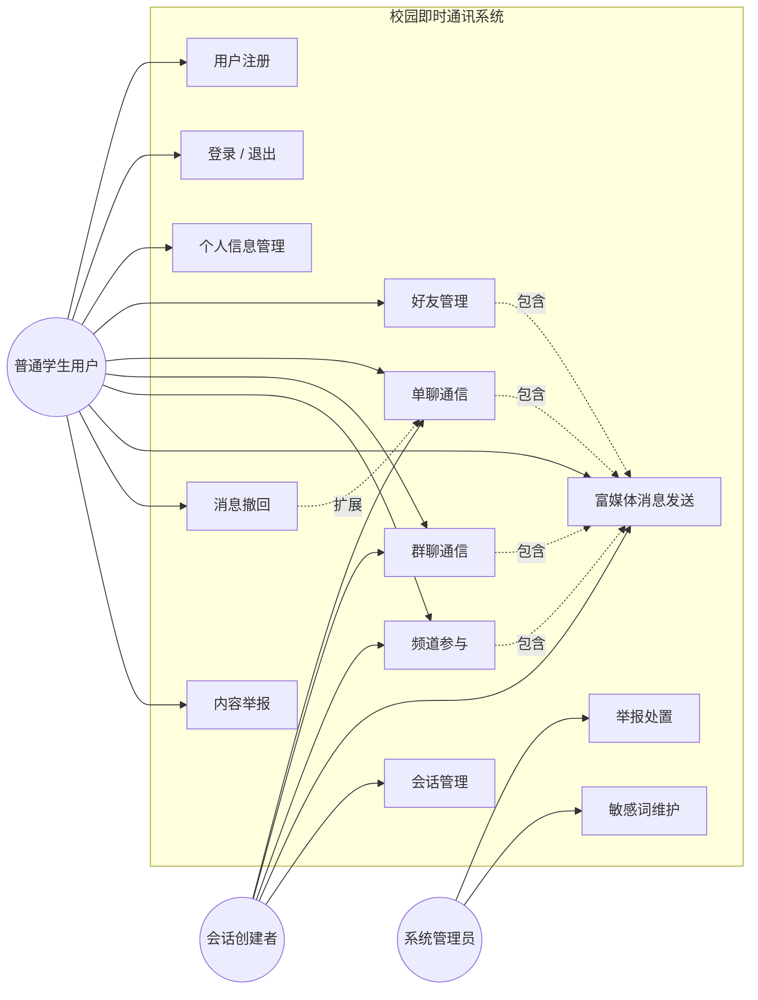
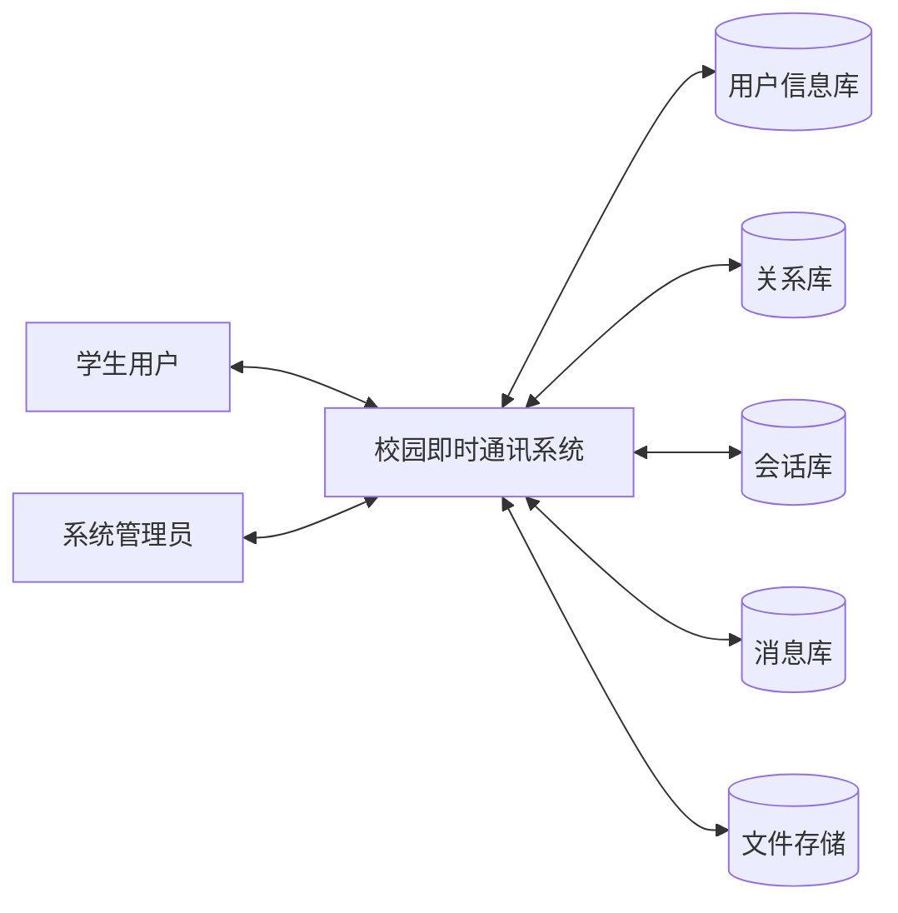

# 第一章 系统需求分析
> E-R 图与数据库物理设计归入第二章 2.4「数据库设计」，本章不展开。
> 正文排版说明（来自模板）：中文宋体小四，行距固定值 22 磅，英文 Times New Roman。本 Markdown 稿仅承载内容。
> 系统名称（暂定）：**校园即时通讯系统（CampusTalk）**

---

## 1.1 引言

### 1.1.1 编写目的

本文档对「校园即时通讯系统」必须实现的功能、性能与运行要求作出完整、可验证的定义，作为后续系统设计（第二章）、编码实现（第三章）与系统测试（第四章）的依据。预期读者为项目开发者、验收人员与后续维护者。

### 1.1.2 背景

即时通讯软件是当代大学生日常沟通的主要工具。本项目要求开发一套在线互动聊天系统，并参照 QQ 给出八项基本功能：整体软件界面、用户注册、用户登录（及退出）、好友管理、个人信息管理、好友通信、群聊、文件 / 图片 / 表情发送。

本系统面向高校班级与社团场景，在完整覆盖上述八项功能的基础上，引入"校园身份（学号 / 院系 / 班级）"与"兴趣频道"两项差异化设计，使系统既区别于通用 IM 的空壳复刻，又能在单人短周期的开发周期内完成。

### 1.1.3 术语和缩略词

| 术语 | 定义 |
|---|---|
| **会话（Conversation）** | 消息收发的容器，分为私聊 `single`、群聊 `group`、频道 `channel` 三种类型，共用同一张表 |
| **频道（Channel）** | 免审加入的公开会话，围绕特定兴趣主题持续讨论，成员之间无需互为好友 |
| **统一会话抽象** | 用 `conversation.type` 字段区分三种会话形态，使收发消息、成员管理、历史拉取等逻辑完全复用的设计方法 |
| **撤回（Recall）** | 将消息的 `recalled_at` 字段置为当前时间，前端渲染为"XX 撤回了一条消息"。**标记行为，不删除数据** |
| **未读红点** | 统计"我还有多少条没看"，基于 `conversation_member.last_read_message_id` 计算 |
| **已读回执** | 显示"对方是否看过我发的消息"。**本系统不做**，与未读红点区分 |
| IM | 即时通讯（Instant Messaging） |
| JWT | JSON Web Token，本系统用于身份认证的无状态令牌 |
| WebSocket | 全双工通信协议，本系统用于消息实时投递 |
| REST | 表征状态转移，本系统用于会失败的操作（注册、加好友、上传等） |

### 1.1.4 参考资料

1. 《在线互动聊天系统开发任务》
2. 《校园即时通讯系统 · 架构与数据设计》（本项目内部文档）
3. 《中华人民共和国网络安全法》《互联网信息服务管理办法》相关条款（合规章节引用时须核对现行有效文本）

---

## 1.2 任务概述

### 1.2.1 建设目标

1. 完整覆盖八项基础功能功能要求，逐条可演示、可追溯（追溯矩阵见 1.5.2）。
2. 引入校园身份体系（学号、院系、班级），让系统有真实的校园场景可用，而不是把通用 IM 换个壳。
3. 用同一套会话抽象同时支撑即时通讯与兴趣社区两种形态，形成可写入报告的设计亮点。
4. 把内容安全放在需求阶段就纳入，明确平台的内容管理责任与实现方案。

### 1.2.2 用户概述

系统面向高校在校学生，由开发者本人兼任系统管理员。详细用户特征与权限见 1.4。

### 1.2.3 运行环境概述

系统采用 B/S 架构，浏览器打开即用，无需安装客户端。开发与演示均在本机 `localhost` 完成，不对外提供服务。详细的软件接口与硬件接口见 1.7。

### 1.2.4 假设与约束

1. 时间约束：单人开发，周期约数周，功能范围严格受时间盒限制。
2. 技术栈约束：不引入消息队列、Nginx、对象存储、Docker Compose 及任何微服务拆分；实时广播引入 Redis 发布-订阅总线（Windows 本机由 Redis 5.0.14.1 服务版提供，只做瞬态通道、不存持久数据）。每引入一个中间件，就增加一个"装不上、起不来、演示现场出故障"的风险点；Redis 作为广播的唯一例外，以硬依赖方式接入（连不上即拒绝启动），风险在启动阶段即暴露而非演示中途。
3. 部署约束：仅本机运行，不购买域名、不做 ICP 备案、不做内网穿透、不对外提供服务。此约束是内容合规风险可控的前提（见 1.6.3）。
4. 异步约束：WebSocket 处理函数中不得使用同步数据库驱动，否则将阻塞整个事件循环。
5. 假设开发与演示环境均可正常运行现代浏览器与 Python 运行时；假设无需支撑大规模并发（设计目标为同时在线数十人量级）。

---

## 1.3 项目概述

### 1.3.1 项目来源及背景

本项目的开发依据是《在线互动聊天系统开发任务》。任务要求开发一套在线互动聊天系统，并列举 QQ、微信、钉钉、飞书、企业微信、社区论坛等参考产品。

经分析，这些参考产品实际分属三个不同品类：

| 品类 | 代表产品 | 关系链位置 | 核心问题 |
|---|---|---|---|
| 社交即时通讯 | QQ、微信 | 熟人关系链 | 我和谁聊 |
| 兴趣社区 | 社区论坛、QQ 频道 | 关系链旁路 | 在哪聊 |
| 协同办公 | 钉钉、飞书、企业微信 | 组织树 | 为了什么聊 |

若将三者全部照搬，在单人短周期的开发周期内必然产生大量半成品功能。任务给出的八项功能要求（界面、注册、登录、好友管理、个人信息、单聊、群聊、文件图片表情）实际是照着"社交即时通讯"品类抄写的，因此本系统确定如下定位：

本系统的定位是：以社交即时通讯为主轴，完整覆盖八项基础功能要求；用"兴趣频道"作为差异化切口，以极低成本纳入社区论坛形态；明确排除协同办公方向。

差异化切口的工程依据是"统一会话抽象"：私聊、群聊、频道三种形态共用同一套会话与消息模型，只在加入策略与置顶能力上存在差异（见 1.5.2）。

### 1.3.2 项目目标

开发一个运行于浏览器端的校园即时通讯系统，实现：

1. 注册登录与个人信息管理；
2. 好友的添加、删除与信息修改（备注名、分组、特别关注）；
3. 单聊与群聊；
4. 文本、表情、图片、文件的发送与接收；
5. 兴趣频道的免审加入与置顶话题帖；
6. 消息撤回（3 分钟内）与未读红点；
7. 规则机器人指令响应；
8. 内容安全：敏感词过滤与举报处置。

### 1.3.3 系统功能概述

系统由 12 个功能模块构成，完整覆盖八项基础功能要求并包含三项扩展与一项内容治理：

| 编号 | 模块 | 子功能 | 来源 |
|---|---|---|---|
| F1 | 统一界面框架 | 七页面统一布局骨架、全局导航 | 基础功能① |
| F2 | 用户注册 | 用户名 / 学号 / 密码 / 昵称 / 院系 / 班级、勾选用户协议、唯一性校验 | 基础功能② |
| F3 | 登录与退出 | 登录校验、JWT 签发、退出登录（清除本地令牌；服务端吊销令牌本期未实现） | 基础功能③ |
| F4 | 个人信息管理 | 查看与修改昵称 / 头像 / 个性签名 / 院系 / 班级、密码修改 | 基础功能⑤ |
| F5 | 好友管理 | 查找用户、申请、同意 / 拒绝、删除好友、修改备注名、设置分组、特别关注 | 基础功能④ |
| F6 | 单聊通信 | 与好友收发消息、查看历史消息 | 基础功能⑥ |
| F7 | 群聊通信 | 创建群组、邀请 / 申请加入、成员管理、群内收发、退出、配置历史可见性 | 基础功能⑥ |
| F8 | 兴趣频道 | 浏览频道广场、按名称 / 简介关键词检索（院系筛选本期未实现）、免审加入、频道内发言、置顶话题帖 | 差异化切口 |
| F9 | 富媒体消息 | 文本、表情面板、图片上传与发送、文件上传与下载、类型与大小校验 | 基础功能⑦ |
| F10 | 消息管理 | 3 分钟内撤回本人消息并广播通知、未读红点统计与清除 | 扩展 |
| F11 | 规则机器人 | 指令响应（如 `/help`）、关键词自动回复 | 扩展 |
| F12 | 内容治理 | 敏感词过滤、举报提交、管理员处置 | 非功能载体 |

---

## 1.4 用户特点

系统定义三类参与者，权限差异集中体现于会话管理。

| 角色 | 身份来源 | 特征 | 核心权限 |
|---|---|---|---|
| **普通学生用户** | 注册获得 | 具备基本计算机操作能力，习惯使用主流 IM，对界面美观度和响应速度有预期 | 注册登录、维护个人资料、好友增删改与备注分组、发起私聊、创建 / 加入群聊、加入频道、发送文本 / 表情 / 图片 / 文件、撤回本人 3 分钟内的消息、举报违规内容 |
| **会话创建者** | 创建群组或频道后自动获得 | 通常由社团负责人或活动组织者兼任 | 在普通用户权限基础上，额外拥有：修改会话名称与头像、移除成员、禁言成员（频道，本期未实现）、设置群聊历史可见性、设置频道置顶话题帖 |
| **系统管理员** | 系统内置，由开发者持有 | 具备数据库与服务器操作能力 | 处理举报、封禁账号、维护敏感词库 |

另需说明：创建者与管理员并非独立的用户表字段，而是由 `conversation.owner_id` 与 `conversation_member.role` 推导得出。不额外建立角色表，是为了避免权限判定逻辑分散在各处。

---

## 1.5 功能需求

### 1.5.1 系统功能

#### 1.5.1.1 功能模块划分

系统功能模块划分见 1.3.3 系统功能概述表（F1–F12）。各模块间存在依赖：F9 富媒体消息被 F5、F6、F7、F8 共同包含；F10 消息管理扩展 F6、F7；F12 内容治理作用于所有会话的发送环节。

#### 1.5.1.2 系统用例图

### 1.5.2 功能描述

本节按功能模块描述，依次给出用例规格、三种会话形态差异、数据流图与需求追溯矩阵。

#### 1.5.2.1 用例规格说明

##### UC-01 用户注册

| 项目 | 内容 |
|---|---|
| 用例编号 | UC-01 |
| 参与者 | 普通学生用户 |
| 前置条件 | 用户已访问系统注册页面 |
| 基本事件流 | 1. 系统展示注册表单（邀请码、用户名、学号、密码、确认密码、昵称、院系、班级） 2. 用户填写表单、填入管理员发放的邀请码并勾选用户协议 3. 用户提交 4. 系统校验：邀请码有效、用户名唯一、学号唯一、密码长度≥6、两次密码一致、密码不为弱口令、已勾选用户协议、必填项非空 5. 校验通过，系统对密码做哈希处理并写入用户表 6. 系统提示注册成功并跳转登录页 |
| 异常事件流 | 4a. 用户名已存在 → 提示"该用户名已被注册"，返回步骤 1 4b. 学号已存在 → 提示"该学号已注册"，返回步骤 1 4c. 未勾选用户协议 → 提示"请先阅读并同意用户协议"，返回步骤 1 4d. 两次密码不一致 → 提示"两次输入的密码不一致"，返回步骤 1 4e. 密码与用户名或学号相同、或命中常见弱口令 → 提示具体原因，返回步骤 1 4f. 邀请码无效 → 提示"邀请码无效，请向管理员获取"，返回步骤 1 |
| 业务规则 | 密码**不做全局唯一性校验**：库中存的是加盐哈希，同一明文每人的哈希值不同，技术上无法比对；且提示"该密码已被使用"会泄露他人密码信息。该取舍须在报告中写明 |
| 后置条件 | 用户表新增一条记录，密码以哈希形式存储 |
| 特殊需求 | 密码必须以哈希形式存储，**任何情况下不得存储或回显明文密码** |

##### UC-02 用户登录与退出

| 项目 | 内容 |
|---|---|
| 用例编号 | UC-02 |
| 参与者 | 普通学生用户 |
| 前置条件 | 用户已注册 |
| 基本事件流 | 1. 用户输入用户名与密码 2. 系统校验凭据，通过后签发 JWT 并返回 3. 前端保存令牌，跳转至会话大厅 4. 用户点击退出 → 前端清除本地令牌，跳转登录页 |
| 异常事件流 | 2a. 用户名不存在或密码错误 → 统一提示"用户名或密码错误"（**不区分具体原因，避免账号枚举**） 2b. 令牌过期 → 任意接口返回 401，前端跳转登录页 |
| 后置条件 | 登录成功后用户可访问所有需鉴权接口；WebSocket 连接需在 query 中携带同一令牌 |

##### UC-03 个人信息管理

| 项目 | 内容 |
|---|---|
| 用例编号 | UC-03 |
| 参与者 | 普通学生用户 |
| 前置条件 | 用户已登录 |
| 基本事件流 | 1. 用户进入个人资料页，系统展示当前信息 2. 用户修改昵称 / 个性签名 / 院系 / 班级，或上传新头像 3. 用户保存 4. 系统更新对应用户记录 5. 系统提示保存成功，会话中的昵称与头像同步刷新 |
| 异常事件流 | 3a. 头像文件超过 2MB 或格式非 jpg / png / gif → 提示具体原因，拒绝上传 |
| 后置条件 | 用户记录更新；其他用户可见更新后的昵称与头像 |
| 业务规则 | 用户名注册后**不可修改**（登录凭据兼检索标识）；学号**不允许用户自助修改**，确需变更时由管理员核实后执行并留痕（见 UC-09） |

##### UC-04 好友管理

| 项目 | 内容 |
|---|---|
| 用例编号 | UC-04 |
| 参与者 | 普通学生用户 |
| 前置条件 | 用户已登录 |
| 基本事件流（添加） | 1. 用户按用户名精确检索（昵称与学号**不可被检索**），或使用"找同班同学"功能 2. 用户向目标发起好友申请，可附申请留言 3. 系统写入 `friendship(申请人, 目标, pending)` 4. 目标收到申请通知，选择同意或拒绝 5. 同意 → 改为 `accepted`，**并反向补写一条 `(目标, 申请人, accepted)`**；拒绝 → 改为 `rejected` 6. 双方好友列表均刷新 |
| 基本事件流（修改信息） | 1. 用户在好友列表中选择某好友 2. 修改备注名、调整分组、切换特别关注 3. 系统更新该用户所持有的好友关系记录 |
| 基本事件流（删除） | 1. 用户选择删除好友 2. 系统二次确认 3. **双向删除**两条记录，私聊会话随之隐藏 |
| 异常事件流 | 2a. 申请对象不存在 → 提示"用户不存在" 2b. 重复申请或已是好友 → 提示当前关系状态，不重复写入 2c. 申请自己 → 拒绝 |
| 后置条件 | 好友关系表状态正确，**任何已成为好友的关系在表中必须存在两条方向相反的记录** |
| 业务规则 | 备注名与分组是**关系持有者的私有数据**，我给对方起的备注不应出现在对方的好友列表中，这也是必须存双向两条记录的原因；好友检索**仅开放用户名精确匹配**，因为昵称可能被填成真实姓名、学号属于半敏感信息，两者都不可被检索，防止"按姓名搜人"式的骚扰 |

##### UC-05 单聊通信

| 项目 | 内容 |
|---|---|
| 用例编号 | UC-05 |
| 参与者 | 普通学生用户 |
| 前置条件 | 双方已是好友（关系状态为 accepted） |
| 基本事件流 | 1. 用户在好友列表中点击某好友，系统查找或创建 `type=single` 的会话 2. 系统按游标分页加载最近 20 条历史消息 3. 用户编辑并发送文本消息 4. 系统校验敏感词 → 消息**先落库** → 再通过 WebSocket 推送给对方 5. 对方客户端实时渲染气泡；若对方离线，下次进入会话时从历史中读取 |
| 异常事件流 | 4a. 消息命中敏感词 → 后端拒绝并返回明确提示，消息不落库 4b. WebSocket 断开 → 消息仍已落库，用户刷新页面后可见（**消息不丢失**） 4c. 双方已非好友 → 拒绝发送 |
| 后置条件 | 消息表新增一条记录，双方未读状态更新 |
| 业务规则 | **消息先落库再推送**，是本系统保证消息不丢的核心设计 |

##### UC-06 群聊通信

| 项目 | 内容 |
|---|---|
| 用例编号 | UC-06 |
| 参与者 | 普通学生用户、会话创建者 |
| 前置条件 | 用户已登录 |
| 基本事件流（创建） | 1. 用户点击创建群聊，填写群名称并选择初始成员（仅可从好友中选择） 2. 系统创建 `type=group` 的会话，写入创建者为 `owner`，并为每位成员写入会话成员记录 3. 跳转群聊界面 |
| 基本事件流（通信） | 4. 群成员发送消息 → 落库 → 推送给群内所有在线成员 5. 成员可查看群成员列表、退出群聊 |
| 基本事件流（管理） | 6. 群主可修改群名称与头像、移除成员、设置历史可见性（全部 / 加入后 / 最近 N 条） |
| 异常事件流 | 1a. 未选择任何成员 → 提示"请至少选择一位成员" 4a. 非群成员尝试发送 → 后端返回 403 |
| 后置条件 | 会话与成员记录正确，消息按可见性规则对成员呈现 |

##### UC-07 兴趣频道

| 项目 | 内容 |
|---|---|
| 用例编号 | UC-07 |
| 参与者 | 普通学生用户、会话创建者 |
| 前置条件 | 用户已登录 |
| 基本事件流 | 1. 用户进入频道广场，系统展示全部频道（名称、简介、成员数） 2. 用户按关键词或院系检索频道 3. 用户点击加入 → **无需审批，立即成为成员**（区别于群聊的唯一差异点） 4. 用户在频道内发言，消息对所有成员可见 5. 频道创建者可将某条消息设为置顶话题帖，所有成员进入时可见 |
| 异常事件流 | 3a. 已是成员 → 提示"你已在该频道中" 4a. 命中敏感词 → 后端拒绝 |
| 后置条件 | 会话成员表新增记录；频道历史消息对新成员**全部可见** |
| 业务规则 | **免审进入 ≠ 免审发言。** 加入无门槛，但发言同样经过敏感词过滤与举报机制约束，二者在设计上必须分开表述 |

##### UC-08 富媒体消息发送

| 项目 | 内容 |
|---|---|
| 用例编号 | UC-08 |
| 参与者 | 普通学生用户 |
| 前置条件 | 用户已在某个会话中 |
| 基本事件流 | 1a. 表情：用户打开表情面板，选择表情插入输入框，随文本一并发送 1b. 图片：用户选择本地图片 → 前端校验类型与大小 → 上传至服务端 → 服务端保存至 `uploads/` 并返回 URL → 以图片类型落库并推送 1c. 文件：流程同图片，额外记录文件名与文件大小 2. 接收方渲染：图片内联显示，文件显示为可下载的卡片 |
| 异常事件流 | 1a. 文件超过 50MB 或类型不在白名单 → 前端拦截并提示；**服务端必须重复校验**（前端校验可被绕过） 1b. 上传失败 → 提示重试，不产生消息记录 |
| 后置条件 | 消息记录中内容字段存 URL 而非二进制；文件本体落 `uploads/` 目录 |
| 业务规则 | **绝不将文件二进制写入数据库或 WebSocket 帧**，数据库只存 URL、文件名与大小 |

##### UC-09 消息撤回

| 项目 | 内容 |
|---|---|
| 用例编号 | UC-09 |
| 参与者 | 普通学生用户 |
| 前置条件 | 消息由本人发送，且发送时间距当前不超过 3 分钟 |
| 基本事件流 | 1. 用户长按或右键点击本人消息，选择撤回 2. 系统校验时间窗与发送者身份 3. 系统将撤回标记字段置为当前时间（**不删除记录**） 4. 系统通过 WebSocket 向会话内其他成员广播撤回通知 5. 各方界面将该气泡替换为"XX 撤回了一条消息" |
| 异常事件流 | 2a. 超过 3 分钟 → 拒绝并提示"该消息已超过可撤回时间"，前端同时隐藏撤回入口 2b. 非本人消息 → 拒绝 |
| 后置条件 | 消息记录保留，撤回标记非空；**未读数统计须排除已撤回消息**，否则会出现"有 1 条未读但点进去什么都没有" |
| 业务规则 | 撤回是标记而非删除，既便于审计，也避免外键与联表错乱 |

##### UC-10 内容举报与处置

| 项目 | 内容 |
|---|---|
| 用例编号 | UC-10 |
| 参与者 | 普通学生用户、系统管理员 |
| 前置条件 | 用户已登录并看到待举报消息 |
| 基本事件流 | 1. 用户对某条消息提交举报并选择理由 2. 系统写入举报表（状态为待处理） 3. 管理员在处置页查看待处理举报列表 4. 管理员处置：标记消息为已处理、对发布者封号（禁言本期未实现） 5. 系统更新举报状态并记录处理人与处理时间 |
| 异常事件流 | 1a. 重复举报同一条消息 → 提示已举报，不重复写入 |
| 后置条件 | 举报记录完整可追溯 |
| 实现阶段 | 后期，属可选项；第一、二周不建立举报表 |

##### UC-11 学号变更申请与审核

| 项目 | 内容 |
|---|---|
| 用例编号 | UC-11 |
| 参与者 | 普通学生（申请人）、系统管理员（审核人） |
| 前置条件 | 申请人已登录；存在转专业、留级或教务录入错误等真实变更事由 |
| 基本事件流 | 1. 申请人填写新学号与变更说明，并**上传证明材料**（学生证照片或学信网截图） 2. 系统校验：新学号非空、与当前学号不同、未被他人占用、本人无进行中的待审申请 3. 系统将证明材料存入**私密目录**（不对外静态暴露），写入申请记录（状态 pending） 4. 管理员在审核列表查看待审申请，调阅证明材料图片 5. 管理员核实材料后选择通过或驳回（驳回必须填写理由） 6. 通过 → 写入新学号并记录审核人与时间；驳回 → 记录理由 7. 系统**删除证明材料原件**，仅保留申请与审核记录；申请人可查看处理进展与审核意见 |
| 异常事件流 | 2a. 新学号与当前相同 → 提示相同，返回步骤 1 2b. 新学号已被占用 → 提示已被使用，返回步骤 1 2c. 已有待审申请 → 提示等待处理，不允许重复提交 2d. 证明材料缺失、类型不符或超过 10MB → 提示具体原因 4a. 非管理员调阅证明材料 → 拒绝（403） 5a. 审核时该学号已被他人占用 → 拒绝通过，需驳回 |
| 后置条件 | 学号变更有据可查：申请材料、审核人、审核意见、审核时间均可追溯；证明材料原件已按最小化原则清除 |
| 业务规则 | 学号是"后台实名"的载体，**不允许用户自助修改**，必须走"提交证明 + 人工核实"的通道；证明材料属敏感个人信息，仅管理员可读取，且在审核结论作出后立即删除原件 |

#### 1.5.2.2 三种会话形态的功能差异

本系统的核心设计决策在于：三种会话形态共用同一套数据模型与消息链路，差异仅集中在下表的三行。

| 需求点 | 私聊 single | 群聊 group | 频道 channel |
|---|---|---|---|
| 加入方式 | 双方成为好友后自动成立 | 群主邀请或申请后群主同意 | **任何人免审直接加入** |
| 历史消息对新成员 | 全部可见 | **由群主配置**（全部 / 加入后 / 最近 N 条） | 全部可见 |
| 置顶话题帖 | 不支持 | 不支持 | **创建者可将帖子设为置顶**（内容层 `post.is_pinned`） |
| 成员管理方式 | 删除好友即消失 | 群主可移除成员 | 创建者可移除成员 |
| 退出方式 | 删除好友 | 主动退群 | 主动退出 |

除上表所列差异外，消息收发、历史拉取、富媒体、撤回、未读统计等逻辑**完全一致**，由同一套代码实现。

> 补充（2026-09-13）：频道除了「容器层」的复用，另有独立的**内容层**，即帖子、评论、点赞三张表（见第二章 2.4）。频道以内容沉淀为主形态，消息流只作为容器层的底层能力保留。

#### 1.5.2.3 数据流图

顶层数据流图（0 层）

1 层数据流图（主要处理过程）

| 处理过程 | 输入数据流 | 输出数据流 | 关联数据存储 |
|---|---|---|---|
| P1 身份认证与资料 | 注册信息、登录凭据、资料修改请求 | 令牌、用户信息 | D1 |
| P2 关系管理 | 好友申请、同意 / 拒绝、备注分组变更 | 好友列表、申请通知 | D2 |
| P3 会话管理 | 建群 / 创建频道请求、加入请求、成员变更 | 会话列表、成员列表 | D3 |
| P4 消息处理 | 发送消息、撤回请求、历史拉取请求 | 消息推送、历史消息 | D4 |
| P5 内容管理 | 图片 / 文件、敏感词库 | 文件 URL、过滤结果 | D5 |
| P6 内容治理 | 举报提交、处置指令 | 举报列表、处置结果 | D4 |

#### 1.5.2.4 需求追溯矩阵（任务条款 → 系统功能）

| 任务条款 | 对应功能模块 | 对应用例 | 验收方式 |
|---|---|---|---|
| ① 整体软件界面 | F1 统一界面框架 | — | 七个页面布局统一，风格一致，无空白或错版页面 |
| ② 用户注册 | F2 用户注册 | UC-01 | 现场注册新账号，用户表新增一行；重复用户名被拒绝 |
| ③ 用户登录（及退出） | F3 登录与退出 | UC-02 | 登录成功进入大厅；退出后需重新登录才能访问 |
| ④ 好友管理（添加 / 删除 / 修改信息） | F5 好友管理 | UC-04 | 申请—同意全流程可演示；删除后双方列表同步消失；备注名仅本人可见 |
| ⑤ 个人信息管理 | F4 个人信息管理 | UC-03 | 修改昵称与头像后，聊天界面同步刷新 |
| ⑥ 好友通信 | F6 单聊通信 | UC-05 | 两个浏览器窗口互发消息，刷新后消息仍在 |
| ⑥ 群聊功能 | F7 群聊通信 | UC-06 | 建群、拉人、群内收发、退群全流程可演示 |
| ⑦ 文件 / 图片 / 表情 | F9 富媒体消息 | UC-08 | 发送图片对方能打开；发送文件对方能下载；表情正常显示 |
| （扩展）兴趣频道 | F8 兴趣频道 | UC-07 | 陌生人不加好友即可进入频道并发言 |
| （扩展）消息撤回 | F10 消息管理 | UC-09 | 3 分钟内撤回成功，对方界面同步变为撤回提示 |
| （非功能）内容安全 | F12 内容治理 | UC-10 | 发送含敏感词的消息被后端拒绝并给出提示 |
| （扩展）学号变更 | F4 个人信息管理 | UC-11 | 用户上传证明材料提交申请；管理员调阅材料后通过 / 驳回；通过后学号更新且材料原件被清除 |

---

## 1.6 性能需求

### 1.6.1 数据精度要求

| 数据项 | 精度 / 范围 | 说明 |
|---|---|---|
| 用户名 | 长度 4–50 字符，唯一 | 登录凭据 |
| 学号 | 长度 ≤32 字符，唯一 | 校园身份核心；**不允许自助修改**，确需变更由管理员核实后执行并留痕（UC-11） |
| 密码 | 长度 ≥6 字符 | 以哈希存储，明文不入库 |
| 昵称 | 长度 ≤50 字符 | 聊天界面显示名 |
| 个性签名 | 长度 ≤200 字符 | — |
| 文本消息 | 长度 ≤5000 字符 | 超长截断或提示分条 |
| 文件大小 | 单个 ≤50 MB | 超限拒绝，前端与服务端双重校验 |
| 图片大小 | 单个 ≤10 MB | 类型限 jpg / png / gif |
| 时间戳 | 精度到秒，统一存 UTC | 展示时转本地时区 |
| 撤回时间窗 | 180 秒（常量化） | 超时不可撤回 |
| 历史消息分页 | 每页 20 条 | 游标分页 |
| 未读数 | 整数，≥0 | 排除已撤回消息 |

### 1.6.2 时间特性

| 指标 | 要求 | 验收方式 |
|---|---|---|
| 消息端到端延迟 | 发送到对方可见 < 1s（同一局域网内） | 两个浏览器窗口实测 |
| 历史消息拉取 | 单群 5000 条内，翻页 < 500ms | 验证 `(conversation_id, created_at)` 联合索引生效 |
| 接口响应 | 普通查询接口 < 200ms | 接口测试 |
| 同时在线 | 支持数十人量级并发 | 满足演示规模 |
| 文件上传 | 10MB 图片上传 < 3s | 实测 |

### 1.6.3 安全性与合规性要求

> 通用需求规格 1.6 仅列 1.6.1 数据精度与 1.6.2 时间特性。本系统涉及用户生成内容，内容安全与合规是不可省略的专门需求，故增设 1.6.3。此节同时支撑 1.7.3 的部署边界。

责任归属方面：用户生成内容平台中，信息管理责任主要由平台运营者承担，而不是发布者个人。运营者依法负有发现违法信息后停止传输、消除处置、保存记录并报告的义务，并需按规定留存网络日志。

> 上述为原则性表述。报告中引用具体法律条款时，须核对现行有效文本，不得照抄二手表述。

风险的分水岭在于是否对外提供服务。本系统只在本机 `localhost` 运行，不购买域名、不备案、不做内网穿透，在这个前提下实际风险接近于零；一旦部署到公网，平台性质与运营者责任都会发生根本变化。

校园身份还有一层合规价值：学号注册天然满足"后台实名、前台自愿"的要求。用户知道自己是实名的，行为预期会收敛，这让"校园场景"从产品卖点变成了合规设计的一部分。

三道防线

| 阶段 | 目标 | 措施 |
|---|---|---|
| 事前 · 不敢发 | 提高违规成本 | 学号注册（后台实名）、注册勾选用户协议与社区规范、频道创建者负责制 |
| 事中 · 发不出 | 技术拦截 | 后端敏感词过滤；图片先存后审本期未实现（上传后立即可见） |
| 事后 · 追得到 | 可追溯可处置 | 一键举报、删帖 / 封号、字段级操作留痕（禁言与独立操作日志表本期未实现） |

还有一条原则要单独强调：免审进入不等于免审发言。频道加入没有门槛，但发言同样要过敏感词过滤和举报机制，这两件事在设计上必须分开表述。

落地清单

| 优先级 | 事项 | 成本 |
|---|---|---|
| 前期必做 | 敏感词过滤（词库 txt + 发送时后端匹配，命中即拒绝） | 约 10 行代码 |
| 前期必做 | 注册页勾选用户协议 | 前端 5 分钟 |
| 前期必做 | 部署边界写死：只跑 localhost | 不写代码 |
| 后期建议 | 举报 + 管理员处置页 + 举报表 | 约半天 |
| 后期建议 | 频道创建者可移除成员（禁言本期未实现） | 顺手实现 |
| 只写不做 | 完整治理机制、日志留存 6 个月、分级处置、AI 生成内容合规 | 报告章节 |

---

## 1.7 运行需求

### 1.7.1 系统界面需求

系统采用 B/S 架构，七个页面共用一套布局骨架，保证界面风格统一：

- **布局骨架**：顶栏（含用户头像、未读汇总、退出入口）+ 左侧列表（会话 / 好友 / 频道切换）+ 右侧内容区（聊天 / 资料 / 管理）。
- **七个页面**：登录页、注册页、会话大厅、聊天页、好友与申请页、个人资料页、频道广场页。
- **响应式**：以桌面浏览器为主目标，宽度 ≥1024px 适配。
- **统一性验收**：新用户无需文档即可走完"注册 → 加好友 → 发消息"（现场盲测 3 分钟）。

### 1.7.2 软件接口

| 接口类型 | 说明 |
|---|---|
| REST API | 负责"会失败的操作"：注册、登录、好友、资料、会话、历史消息、文件上传。认证走 `Authorization: Bearer <jwt>`，越权访问返回 403 |
| WebSocket | 只负责实时投递：`/ws?token=xxx`。帧类型 4 种：`send_message` / `receive_message` / `typing` / `system_notice`（撤回通知、AI 总结均走系统通知或接收消息）。校验失败直接关闭连接 |
| 数据库访问 | 通过 SQLAlchemy 2.0 异步栈 + `aiomysql` 驱动访问 MySQL 26.7，**WebSocket 处理函数中不得使用同步数据库驱动** |
| 大模型 API（可选） | 用于 AI 群聊总结（后期阶段，可裁剪）。**必须实现优雅降级**：调用失败时向会话发送系统提示，聊天不中断 |

### 1.7.3 硬件接口

| 项目 | 配置 |
|---|---|
| 客户端 | Chrome / Edge 等现代浏览器（支持 WebSocket） |
| 服务端 | 开发者自有计算机，Python 3.11+ / FastAPI / Uvicorn |
| 数据库 | MySQL 26.7（本地服务，端口 3306），库名 `campustalk`，字符集 `utf8mb4` |
| 文件存储 | 本地 `uploads/` 目录，不使用对象存储 |
| **部署边界（强制）** | **仅本机 `localhost` 运行，不购买域名、不做 ICP 备案、不做内网穿透、不对外提供服务。** 此约束是 1.6.3 合规风险可控的前提，一旦突破，系统的法律性质与运营者责任随之改变 |

---

## 本章验收标准

| 序号 | 验收项 | 判定标准 |
|---|---|---|
| 1 | 基本功能正确运行 | 注册、登录、加好友、单聊、群聊、频道、传图传文件、撤回，逐项现场演示通过 |
| 2 | 界面完整、布局统一 | 七个页面均可访问且风格统一，无错版 |
| 3 | 前后端数据库操作完整 | 所有列表数据来自数据库查询；现场注册新用户后好友检索可查到；现场发消息后消息表新增记录 |
| 4 | 前后端通信正常 | WebSocket 实时收发可见；REST 与 WebSocket 双通道职责清晰 |
| 5 | 数据一致性 | 好友关系双向存储正确；撤回后未读数不虚增 |
| 6 | 内容安全 | 含敏感词消息被后端拒绝，前端提示明确 |

---

## 需求变更记录

| 版本 | 日期 | 变更内容 | 变更原因 |
|---|---|---|---|
| V1.0 | 2026-09-07 | 初稿 | 需求分析阶段 |
| V1.1 | 2026-09-07 | 章节结构对齐：本章改为「第一章 系统需求分析」，编号 1.1–1.7；E-R 图与数据库物理设计移出本章（归入第二章 2.4）；新增 1.6.3 安全性与合规性 | 章节结构定稿 |
| V1.2 | 2026-09-13 | 频道（F8）形态由「聊天容器」升级为「论坛 / 朋友圈式内容社区」：容器层仍复用 `conversation.type='channel'`，内容层新增 `post` / `comment` / `like` 三张独立表（见第二章 2.4）；1.5.2.2 差异表中「置顶话题帖」一行相应改为指向帖子内容层 | 实现阶段确定频道以内容沉淀为主形态，文档与实现对齐 |
